# SmritiSetu — AI-Powered Cognitive Gaming & Memory Assistance Platform
## Detailed Approach & Technical Documentation
### *For Elderly Dementia Patients in India's North Eastern Region (NER)*

---

> **SmritiSetu** (Sanskrit: स्मृतिसेतु — "Bridge of Memory") is an AI-enabled cognitive therapy platform that combines adaptive gaming, multilingual voice interaction, and caregiver analytics to strengthen cognitive health for elderly dementia patients across India's North Eastern Region.

---

## Table of Contents

1. [Executive Summary](#1-executive-summary)
2. [Problem Analysis & Research Foundation](#2-problem-analysis--research-foundation)
3. [Solution Overview — SmritiSetu](#3-solution-overview--smritisetu)
4. [System Architecture](#4-system-architecture)
5. [Module 1: Adaptive Cognitive Gaming Engine](#5-module-1-adaptive-cognitive-gaming-engine)
6. [Module 2: Voice-Enabled Multilingual Interface](#6-module-2-voice-enabled-multilingual-interface)
7. [Module 3: Smart Reminder & Daily Assistance System](#7-module-3-smart-reminder--daily-assistance-system)
8. [Module 4: Caregiver Dashboard & Analytics](#8-module-4-caregiver-dashboard--analytics)
9. [Module 5: Offline-First Architecture](#9-module-5-offline-first-architecture)
10. [Cultural Localization Strategy for NER](#10-cultural-localization-strategy-for-ner)
11. [AI/ML Architecture & Algorithms](#11-aiml-architecture--algorithms)
12. [UI/UX Design Philosophy](#12-uiux-design-philosophy)
13. [Data Privacy & Security Compliance](#13-data-privacy--security-compliance)
14. [Technology Stack](#14-technology-stack)
15. [Implementation Roadmap](#15-implementation-roadmap)
16. [Clinical Validation Strategy](#16-clinical-validation-strategy)
17. [Impact Assessment & Metrics](#17-impact-assessment--metrics)
18. [Risk Analysis & Mitigation](#18-risk-analysis--mitigation)
19. [Budget Estimation](#19-budget-estimation)
20. [References & Research Papers](#20-references--research-papers)

---

## 1. Executive Summary

### The Crisis

India's North Eastern Region — comprising Assam, Arunachal Pradesh, Manipur, Meghalaya, Mizoram, Nagaland, Sikkim, and Tripura — faces a convergence of demographic and healthcare challenges:

| Statistic | Data |
|:---|:---|
| **Dementia prevalence (India, 60+)** | ~7.4% (~8.8–9 million individuals) |
| **NER elderly population growth** | Accelerating due to demographic transition |
| **Neurologists per million (NER)** | Critically below national average |
| **Internet connectivity (rural NER)** | Intermittent; many areas lack 4G coverage |
| **Predominant languages** | 200+ languages across 3 linguistic families |

> [!CAUTION]
> In many NER communities, early dementia symptoms are attributed to "normal aging" or supernatural causes, causing families to delay seeking care until advanced stages — **missing the critical window for cognitive intervention**.

### The Solution

**SmritiSetu** is a mobile-first, offline-capable, AI-powered cognitive gaming and memory assistance platform that:
- Delivers **culturally familiar, adaptive cognitive games** in regional NER languages
- Uses **AI/ML to personalize difficulty** based on real-time patient performance
- Provides **voice-first interaction** in Assamese, Bodo, Manipuri, Mizo, Khasi, and Hindi
- Includes **smart reminders** for medicines, hydration, appointments, and daily routines
- Offers a **caregiver dashboard** with cognitive trajectory tracking and alert systems
- Works **fully offline**, syncing when connectivity is available
- Maintains **elderly-friendly UI** with large fonts, high contrast, and minimal cognitive load

---

## 2. Problem Analysis & Research Foundation

### 2.1 Epidemiological Context

Based on data from the **Longitudinal Aging Study in India (LASI)** and collaborative AIIMS/USC studies:

- **National dementia burden**: ~7.4% of adults aged 60+, equating to 8.8–9 million individuals
- **Regional clinical studies** (e.g., hospital-based evaluations in Assam) show:
  - Alzheimer's and Frontotemporal Dementia form a major proportion of cases
  - A significant portion is linked to **vascular dementia**
  - Critically, many cases involve **reversible causes** (nutritional deficiencies, infections, metabolic imbalances) that go undiagnosed due to lack of screening

> **Source**: Longitudinal Aging Study in India (LASI); World Dementia Council; Ovid/Journal of Neurosciences in Rural Practice

### 2.2 NER-Specific Healthcare Barriers

| Barrier | Impact |
|:---|:---|
| **Geographical Isolation** | Dense forests, hilly terrain, poor road connectivity make routine cognitive assessments impossible |
| **Specialist Shortage** | Acute scarcity of geriatricians, neurologists, neuropsychologists — concentrated only in Guwahati, Imphal, Shillong |
| **Stigma & Low Awareness** | Dementia symptoms mistakenly viewed as inevitable aging or supernatural causes |
| **Economic Vulnerability** | Catastrophic out-of-pocket costs for travel to tertiary care facilities |
| **Caregiver Burden & Migration** | Youth migration leaves elderly couples without support; no formal respite care exists |
| **Digital Divide** | Intermittent connectivity; low digital literacy among elderly |

### 2.3 Evidence Base for Digital Cognitive Interventions

#### Meta-Analysis Findings (2024–2025)

Major systematic reviews from **Frontiers in Aging Neuroscience** and **PMC** confirm:

- **Statistically significant improvements** in global cognition via structured digital gaming interventions:
  - **MoCA scores**: Mean improvement of 1.5–3.2 points over 8–12 week interventions
  - **MMSE scores**: Consistent positive delta across randomized controlled trials
  - **Executive functions**: Improved Trail Making Test (TMT-A, TMT-B) execution times
- **Adaptive difficulty** significantly reduces dropout rates vs. fixed-difficulty programs
- Dynamic AI adjustment keeps patients in the **"flow state"** — the optimal zone between frustration and boredom

> **Key Paper**: *"The effects of video games on cognitive function in older adults with mild cognitive impairment: a meta-analysis"* — Frontiers, 2025

#### The CTC Framework (2025)

The **Coach–Teacher–Companion (CTC) Tri-Agent Generative AI Framework** (MDPI, Dec 2025) demonstrates:
- Multi-agent LLMs can monitor technology anxiety, assess digital literacy, and customize micro-games
- Systems can safeguard emotional safety while adapting cognitive challenges
- The tri-agent model addresses: behavioral support (Coach), cognitive training (Teacher), emotional companionship (Companion)

> **Key Paper**: *"A Generative AI Framework for Cognitive Intervention in Older Adults"* — MDPI, Dec 2025
https://www.mdpi.com/2227-9032/13/24/3225?utm_source=chatgpt.com

#### Reminiscence Therapy Evidence

Cochrane meta-analyses and clinical trials confirm:
- **Long-term autobiographical memory** remains preserved well into middle-stage dementia — RT specifically targets these neural pathways
- **Culturally familiar stimuli** (traditional textiles, folk music, native language phrases, regional cuisine visuals) **amplify** intervention impact over generic cues
- Positive reminiscence alleviates **depression, anxiety, and agitation**
- Technology-assisted RT using multimedia touchscreens with localized archival content shows enhanced engagement

> **Key Paper**: *"Dementia Therapy: The Role of Gamified AI and Digital Art in Supporting Cognitive and Emotional Well-being"* — ResearchGate, 2025
https://www.researchgate.net/publication/389738769_Dementia_Therapy_The_Role_of_Gamified_AI_and_Digital_Art_in_Supporting_Cognitive_and_Emotional_Well-being

#### Medication Adherence Evidence

Clinical studies on smart reminder systems show:
- Baseline medication adherence (~50% in unassisted populations) rises to **>90%** with automated dispensers and tracking
- Tiered alert systems (patient cue → escalation → caregiver notification) are most effective
- AI-enabled systems that predict non-adherence windows and trigger early prompts show superior outcomes
- Reliable medication management is a **cornerstone for allowing aging-in-place**

---

## 3. Solution Overview — SmritiSetu

### 3.1 Platform Vision

```
┌─────────────────────────────────────────────────────────────────────┐
│                         SmritiSetu Platform                         │
├─────────────┬──────────────┬──────────────┬────────────┬────────────┤
│  Cognitive   │    Voice     │    Smart     │  Caregiver │  Offline   │
│   Gaming     │ Multilingual │  Reminder    │ Dashboard  │   Sync     │
│   Engine     │  Interface   │   System     │ & Analytics│   Engine   │
├─────────────┴──────────────┴──────────────┴────────────┴────────────┤
│                    AI/ML Personalization Layer                       │
├─────────────────────────────────────────────────────────────────────┤
│              Cultural Localization & NER Content Layer               │
├─────────────────────────────────────────────────────────────────────┤
│                  Offline-First Data & Sync Layer                    │
├─────────────────────────────────────────────────────────────────────┤
│              Security, Privacy & Compliance Layer                   │
└─────────────────────────────────────────────────────────────────────┘
```

### 3.2 User Personas

| Persona | Description | Primary Needs |
|:---|:---|:---|
| **Elderly Patient** | 60–85+ years, mild-to-moderate dementia, limited digital literacy, speaks regional NER language | Simple interface, voice-first, culturally familiar content, gentle reminders |
| **Family Caregiver** | Adult child or spouse, often remote (migrated), moderate tech literacy | Progress tracking, alerts, appointment management, peace of mind |
| **Healthcare Worker** | ASHA/ANM worker, community health volunteer, or visiting neurologist | Patient registry, cognitive score trends, clinical reporting tools |
| **Clinician** | Neurologist/geriatrician at district/state hospital | Aggregated analytics, MMSE/MoCA digital tracking, intervention planning |

### 3.3 Core Principles

1. **Offline-First**: Every feature works without internet; sync happens opportunistically
2. **Voice-First**: Primary interaction through speech in native languages
3. **Culturally Rooted**: Games, visuals, sounds, and themes drawn from NER heritage
4. **Clinically Validated**: Aligned with MoCA/MMSE scoring frameworks and evidence-based interventions
5. **Caregiver-Inclusive**: Reduces burden through automation and remote visibility
6. **Privacy-by-Design**: DPDP Act 2023 compliant; data minimization; local-first storage

---

## 4. System Architecture

### 4.1 High-Level Architecture

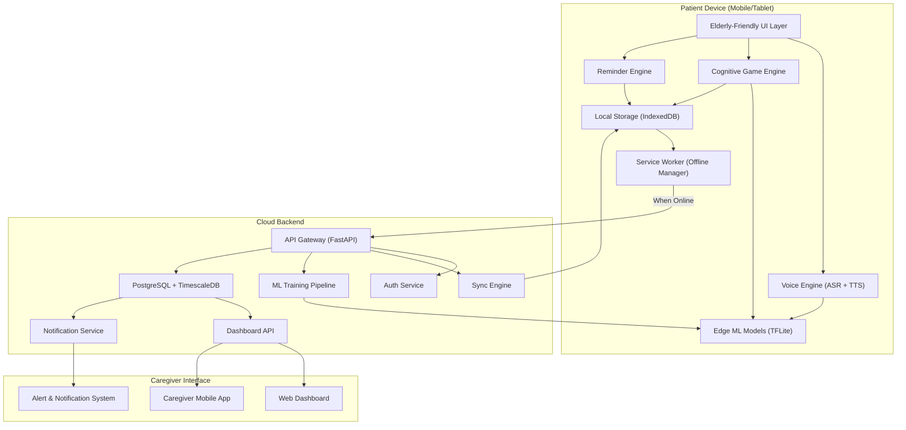

### 4.2 Component Breakdown

| Component | Technology | Purpose |
|:---|:---|:---|
| **Patient App** | React Native / Flutter + PWA fallback | Cross-platform mobile app with offline-first architecture |
| **Voice Engine** | Whisper (fine-tuned) + AI4Bharat IndicWhisper + BHASHINI APIs | Multilingual ASR for NER languages |
| **TTS Engine** | AI4Bharat IndicTTS + Coqui TTS (offline) | Natural, warm voice output in regional languages |
| **Game Engine** | Phaser.js / PixiJS (embedded in app) | Lightweight 2D game rendering with smooth animations |
| **Edge ML** | TensorFlow Lite / ONNX Runtime Mobile | On-device difficulty adaptation and performance scoring |
| **Local Storage** | IndexedDB (via Dexie.js) + SQLite | Patient data, game state, offline queue |
| **Service Worker** | Workbox (Google) | Caching, background sync, offline shell |
| **Backend API** | Python FastAPI | RESTful + WebSocket endpoints |
| **Database** | PostgreSQL + TimescaleDB extension | Relational data + time-series cognitive metrics |
| **ML Pipeline** | PyTorch + MLflow | Model training, A/B testing, continuous improvement |
| **Dashboard** | Next.js + D3.js / Recharts | Caregiver and clinician analytics interface |
| **Notifications** | Firebase Cloud Messaging + SMS (via Twilio/MSG91) | Multi-channel caregiver alerts |

---

## 5. Module 1: Adaptive Cognitive Gaming Engine

### 5.1 Game Categories & Clinical Mapping

Each game targets specific cognitive domains mapped to standard neuropsychological assessments:

| Cognitive Domain | Game Name | Description | Clinical Mapping |
|:---|:---|:---|:---|
| **Short-Term Memory** |  *Smriti Khel* (Memory Match) | Match pairs of culturally themed cards (Bihu dancers, Muga silk patterns, bamboo items) | Digit Span Forward; Visual Memory subtests |
| **Episodic Memory** |  *Purani Yaadein* (Old Memories) | Reminiscence-based: identify and sequence historical NER photos, festivals, old radio songs | Autobiographical Memory Interview (AMI) |
| **Working Memory** |  *Kramanusaar* (Sequence) | Remember and reproduce increasingly complex sequences of NER musical instruments, folk patterns | Digit Span Backward; N-Back task |
| **Attention & Concentration** |  *Dhyan Dhari* (Focus Finder) | Spot differences in NER landscape scenes; track moving objects among distractors | Trail Making Test A (TMT-A) |
| **Pattern Recognition** |  *Naksha Pahchan* (Pattern ID) | Complete traditional weaving patterns (Muga, Puan, Mekhela); identify regional motifs | Matrix Reasoning; Visual Puzzles |
| **Daily Routine Recall** |  *Din Charya* (Daily Routine) | Sequence daily activities (morning prayer → tea → medicine → garden); gamified life-simulation | Functional Assessment |
| **Executive Function** |  *Budhi Paheli* (Wisdom Puzzle) | Planning tasks: arrange festival preparation steps, navigate village paths, sort market items | TMT-B; Tower of London |
| **Language & Naming** |  *Naam Batao* (Name It) | Name objects, animals, plants native to NER from images; voice-activated responses | Boston Naming Test analog |
| **Emotional Engagement** |  *Sur Sangam* (Melody Match) | Listen to and identify NER folk songs, Bihu rhythms, Naga folk tunes; emotional memory activation | Mood assessment via engagement metrics |
| **Social Interaction** |  *Katha Sunao* (Story Circle) | Collaborative storytelling: patient contributes to a community story with AI assistance | Communication assessment |

### 5.2 Adaptive Difficulty System

The difficulty adaptation engine uses a **multi-layered approach**:

#### Layer 1: Rule-Based Baseline (Immediate)
```
IF accuracy > 85% for 3 consecutive rounds:
    INCREASE difficulty (add items, reduce time, add distractors)
ELIF accuracy < 40% for 2 consecutive rounds:
    DECREASE difficulty (fewer items, more time, remove distractors)
ELSE:
    MAINTAIN current level
```

#### Layer 2: Reinforcement Learning (Session-Level)
- **Algorithm**: Q-Learning with Thompson Sampling
- **State Space**: {accuracy, reaction_time, error_type, session_duration, frustration_index}
- **Action Space**: {increase_speed, decrease_speed, add_items, remove_items, add_hints, change_modality}
- **Reward Function**: Weighted combination of engagement duration, accuracy, and emotional response

```python
# Simplified RL-based difficulty adjustment
class CognitiveDifficultyAgent:
    def __init__(self):
        self.q_table = {}  # State → Action → Q-value
        self.alpha = 0.1   # Learning rate
        self.gamma = 0.95  # Discount factor
        self.epsilon = 0.1 # Exploration rate

    def compute_state(self, session_data):
        accuracy = session_data['accuracy']
        reaction_time = session_data['avg_reaction_time']
        frustration = session_data['frustration_index']
        return (
            discretize(accuracy, bins=[0.3, 0.5, 0.7, 0.9]),
            discretize(reaction_time, bins=[2.0, 5.0, 10.0]),
            discretize(frustration, bins=[0.3, 0.6])
        )

    def select_action(self, state):
        if random.random() < self.epsilon:
            return random.choice(ACTIONS)
        return max(ACTIONS, key=lambda a: self.q_table.get((state, a), 0))

    def update(self, state, action, reward, next_state):
        old_q = self.q_table.get((state, action), 0)
        max_future = max(self.q_table.get((next_state, a), 0) for a in ACTIONS)
        self.q_table[(state, action)] = old_q + self.alpha * (
            reward + self.gamma * max_future - old_q
        )
```

#### Layer 3: Predictive Model (Long-Term)
- **Algorithm**: Random Forest / Gradient Boosted Trees
- **Input Features**: Baseline MoCA/MMSE scores, age, education level, 30-day gameplay history, medication regime
- **Output**: Predicted optimal difficulty trajectory for the next 7 days
- **Retraining**: Weekly, using federated learning to preserve privacy

### 5.3 Frustration Detection

The system monitors for signs of frustration or disengagement:

| Signal | Detection Method | Response |
|:---|:---|:---|
| Repeated incorrect taps on same wrong answer | Input pattern analysis | Show gentle hint with audio cue |
| Sudden increase in reaction time | Time-series anomaly detection | Reduce difficulty, offer encouragement |
| Prolonged inactivity (>30 seconds) | Timer + touch sensor inactivity | Voice prompt: "Take your time, no hurry" |
| Device shake / aggressive tapping | Accelerometer data | Switch to calming activity (music, photo slideshow) |
| Abrupt session termination | App lifecycle events | Log for caregiver; suggest shorter sessions next time |

---

## 6. Module 2: Voice-Enabled Multilingual Interface

### 6.1 Language Support Matrix

| Language | Family | Script | Priority | ASR Model |
|:---|:---|:---|:---|:---|
| **Hindi** | Indo-Aryan | Devanagari | Phase 1 | Whisper Large v3 + fine-tuning |
| **Assamese** | Indo-Aryan | Eastern Nagari | Phase 1 | AI4Bharat IndicWhisper + BHASHINI |
| **Bengali** | Indo-Aryan | Bengali | Phase 1 | AI4Bharat IndicWhisper |
| **Manipuri (Meiteilon)** | Tibeto-Burman | Meitei/Bengali | Phase 2 | Custom fine-tuned Whisper (LoRA) |
| **Bodo** | Tibeto-Burman | Devanagari | Phase 2 | Custom fine-tuned Whisper (LoRA) |
| **Mizo** | Tibeto-Burman | Roman | Phase 2 | Custom fine-tuned Whisper (LoRA) |
| **Khasi** | Austroasiatic | Roman | Phase 3 | Custom fine-tuned Whisper (LoRA) |
| **Nagamese** | Creole | Roman | Phase 3 | Custom fine-tuned Whisper (LoRA) |

### 6.2 Voice Architecture

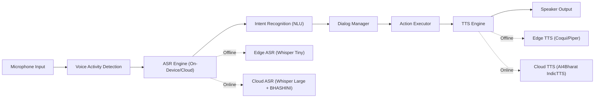

### 6.3 Elderly-Specific Voice Design

| Challenge | Solution |
|:---|:---|
| Lower vocal projection, tremor | ASR models fine-tuned on elderly speech demographics using LoRA/PEFT |
| Slower speech rate, long pauses | Extended Voice Activity Detection (VAD) timeout; patience-mode |
| Code-switching (mixing languages) | Multi-language intent detection; graceful language switching |
| Difficulty with wake words | Large physical "Talk" button on screen; no wake word required |
| Fear of technology | Warm, empathetic TTS voice; recorded family-member greetings |
| Confirmation anxiety | Always repeat understood intent: *"Aapne kaha — dawai ka samay. Sahi hai?"* |

### 6.4 Key Voice Commands

```
"Khel shuru karo"          → Start a cognitive game
"Dawai ka samay"           → Check next medicine reminder
"Aaj kya karna hai"        → List today's activities
"[Family member] ko bulao" → Call caregiver
"Madad chahiye"            → Help / Assistance mode
"Awaaz badha do"           → Increase volume
"Game bandh karo"          → End current game session
```

---

## 7. Module 3: Smart Reminder & Daily Assistance System

### 7.1 Reminder Categories

| Category | Examples | Alert Type |
|:---|:---|:---|
| ** Medicine** | Morning pills, evening insulin, weekly supplements | Tiered: Gentle chime → Voice prompt → Caregiver SMS |
| ** Hydration** | Hourly water reminders (adjusted for season/temperature) | Soft audio cue + animated glass of water |
| ** Daily Activities** | Morning walk, breakfast, prayer time, evening tea | Visual schedule + voice narration |
| ** Medical Appointments** | Doctor visits, physiotherapy, lab tests | Day-before + morning-of + 1-hour-before alerts |
| ** Cognitive Exercise** | Scheduled game sessions | Encouraging voice: *"Khel ka samay ho gaya! Aaj kya khelein?"* |
| ** Social Connection** | Weekly family call, community center visits | Gentle reminder + one-tap call initiation |

### 7.2 Tiered Alert Escalation

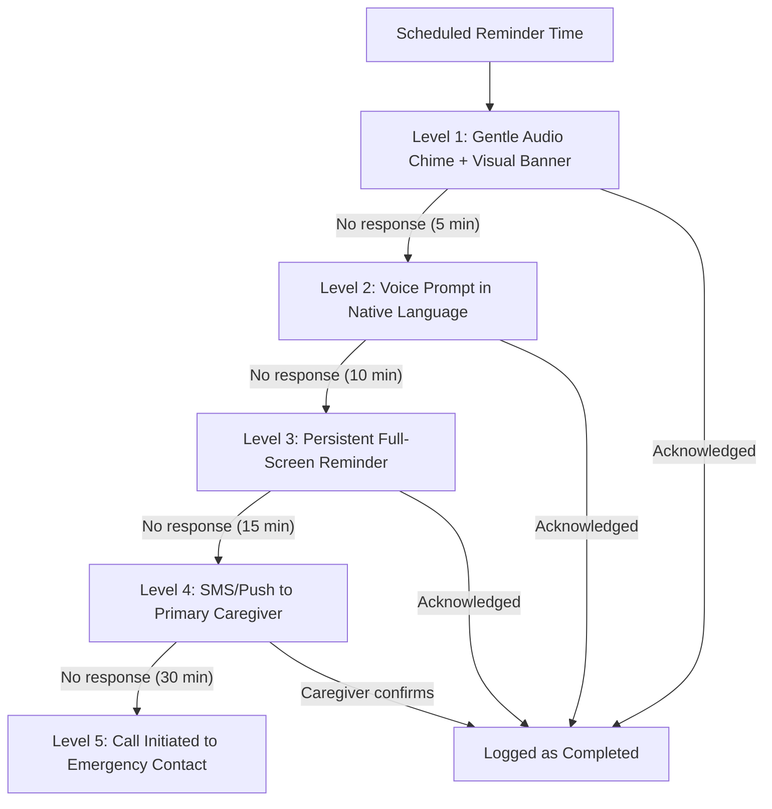

### 7.3 Smart Scheduling with AI

- **Circadian Rhythm Adaptation**: Reminders adjust to patient's observed wake/sleep patterns
- **Medication Interaction Awareness**: Flags potential timing conflicts between medicines
- **Weather-Aware Hydration**: Increases hydration reminders during hot/humid NER summers
- **Festival Calendar Integration**: Adjusts routines during Bihu, Chapchar Kut, etc. when schedules shift

---

## 8. Module 4: Caregiver Dashboard & Analytics

### 8.1 Dashboard Components

```
┌─────────────────────────────────────────────────────────────────┐
│  SmritiSetu — Caregiver Dashboard                [Aarav Deka]│
├───────────────────────┬─────────────────────────────────────────┤
│                       │                                         │
│   Patient Profile   │   Cognitive Score Trajectory          │
│  ───────────────────  │  ──────────────────────────────         │
│  Name: Bimala Devi    │  [Line chart: MoCA-equivalent score     │
│  Age: 74              │   over 30/60/90 days with trend line]   │
│  Stage: Mild (MoCA:22)│                                        │
│  Language: Assamese   │   Domain-wise Performance             │
│  Caregiver: Aarav     │  ──────────────────────────────         │
│                       │  Memory: ████████░░ 78%                 │
│   Status: Active    │  Attention: ██████░░░░ 62%              │
│  Last active: 2h ago  │  Pattern: █████████░ 88%                │
│                       │  Language: ███████░░░ 71%               │
│   Quick Actions     │  Executive: █████░░░░░ 55%              │
│  ───────────────────  │                                         │
│   Call Patient      │   Today's Activity                    │
│   Update Medicine   │  ──────────────────────────────         │
│   Schedule Visit    │   Morning Medicine (8:15 AM)          │
│   Send Reminder     │   Memory Match — Score: 82%           │
│                       │   Hydration (10:00 AM)                │
│                       │   Afternoon Game (pending)            │
│                       │   Evening Medicine (6:00 PM)          │
├───────────────────────┴─────────────────────────────────────────┤
│   Alerts                                                      │
│  ─────────────────────────────────────────────                  │
│    Attention score dropped 15% over past week — Recommend     │
│      clinician review                                           │
│    Evening medicine missed 3 times this week                  │
│    Overall cognitive engagement UP 12% this month             │
└─────────────────────────────────────────────────────────────────┘
```

### 8.2 Key Analytics & Metrics

| Metric | Computation | Clinical Relevance |
|:---|:---|:---|
| **Cognitive Score Trajectory** | Weighted composite of game performance mapped to MoCA-equivalent | Tracks overall cognitive drift over weeks/months |
| **Domain-Specific Scores** | Per-game accuracy, reaction time, completion rate | Identifies which cognitive domains are declining fastest |
| **Behavioral Deviation Index** | Compares current routines to 30-day baseline | Flags sudden changes (agitation, depression, sundowning) |
| **Engagement Duration** | Daily/weekly time spent in games & activities | Correlates with intervention adherence |
| **Medication Adherence Rate** | Acknowledgements / Scheduled reminders × 100 | Direct health outcome predictor |
| **Sleep Pattern Proxy** | Inferred from device usage patterns (first/last activity) | Sleep disruption correlates with cognitive flare-ups |
| **Frustration Index** | Computed from error patterns, abandonment rate, input aggression | Triggers difficulty reduction & caregiver alerts |
| **Social Interaction Score** | Calls made, story participation, family engagement events | Isolation is a major dementia accelerator |

### 8.3 Alert System

| Alert Level | Trigger | Action |
|:---|:---|:---|
|  **Informational** | Positive trend, milestone achieved | Dashboard badge; optional push notification |
|  **Warning** | Missed medicines (2+), declining game scores, reduced engagement | Push notification to caregiver |
|  **Critical** | 15%+ cognitive score drop in one week, complete inactivity for 24h+, SOS trigger | Push + SMS + Auto-call to caregiver & emergency contact |

---

## 9. Module 5: Offline-First Architecture

### 9.1 Why Offline-First is Non-Negotiable

> [!IMPORTANT]
> In NER's remote areas, internet connectivity can be unavailable for **days or weeks**. Any solution that requires constant connectivity will fail. SmritiSetu is designed with an **offline-first philosophy** — the internet is a bonus, not a requirement.

### 9.2 Offline Capabilities

| Feature | Offline Support | Sync Strategy |
|:---|:---|:---|
| All cognitive games |  Full | Game assets pre-cached; scores queued |
| Voice interaction |  Edge models (Whisper Tiny + Piper TTS) | Cloud models used when online for better accuracy |
| Medicine reminders |  Full | Acknowledgements queued for sync |
| Daily schedule |  Full | New schedules pushed on next sync |
| Caregiver alerts |  Queued | SMS sent on connectivity; critical alerts retry every 5 min |
| Dashboard |  Last-synced view | Full refresh on connectivity |
| New content download |  Requires connectivity | Background download with resume support |

### 9.3 Technical Implementation

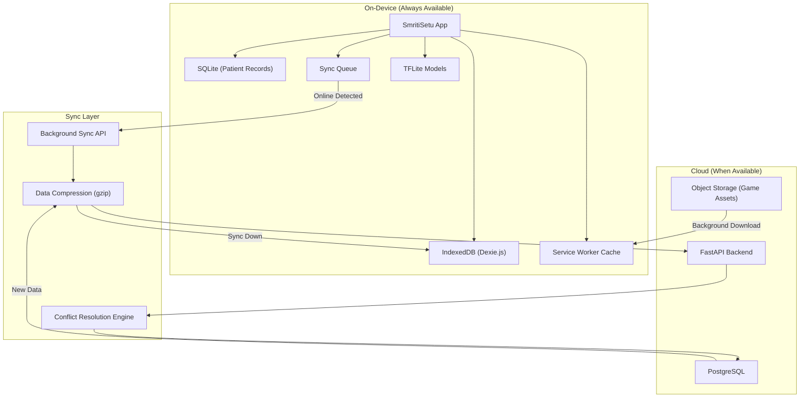

### 9.4 Conflict Resolution Strategy

When multiple caregivers or devices update records offline:

1. **Medication schedules**: Last-Write-Wins with caregiver authority hierarchy
2. **Game scores**: Append-only (no conflicts possible)
3. **Patient profile**: Field-level merge with manual review for conflicts
4. **Reminder settings**: Caregiver's device takes precedence; patient changes are flagged for review

### 9.5 Storage Budget

| Data Type | Estimated Size | Storage Location |
|:---|:---|:---|
| App shell (HTML/CSS/JS) | ~5 MB | Service Worker Cache |
| Game assets (images, audio) | ~50–80 MB | IndexedDB + Cache |
| Edge ML models | ~20–30 MB | App storage |
| Offline TTS voice packs | ~15 MB per language | App storage |
| Offline ASR model (Whisper Tiny) | ~40 MB | App storage |
| Patient data (1 year) | ~2–5 MB | SQLite |
| **Total** | **~150–180 MB** | Fits on budget smartphones (16GB+) |

---

## 10. Cultural Localization Strategy for NER

### 10.1 Culturally Themed Game Content

> [!TIP]
> **Reminiscence therapy research** confirms that culturally familiar stimuli trigger deep-seated autobiographical memory networks more effectively than generic content. This is the foundation of SmritiSetu's content strategy.

#### Assam (Assamese)

| Game Element | Cultural Integration |
|:---|:---|
| Memory Match cards | Bihu dancers, Gamocha patterns, Muga silk motifs, one-horned rhino, tea gardens |
| Pattern completion | Mekhela Chador weaving patterns, Jaapi designs |
| Sound recognition | Bihu songs (Husori, Bihugeet), Pepa (horn instrument), Dhol rhythms |
| Daily routine simulation | Morning Naam (prayer), Tamul-Paan (betel nut ritual), rice cultivation steps |
| Photo reminiscence | Historic Guwahati, Kamakhya temple, Brahmaputra scenes, old Bihu photos |

#### Manipur (Manipuri / Meiteilon)

| Game Element | Cultural Integration |
|:---|:---|
| Memory Match cards | Rasa Lila dancers, Kangla Fort, Loktak Lake, Shirui Lily |
| Pattern completion | Phanek (sarong) patterns, Moirang Kanba designs |
| Sound recognition | Pena (traditional instrument) melodies, folk songs, Thabal Chongba rhythms |
| Daily routine simulation | Ama prayer, Eromba preparation (traditional dish), Sagol Kangjei |
| Martial arts game | Thang-Ta (sword & spear) pattern recall and sequencing |

#### Meghalaya (Khasi)

| Game Element | Cultural Integration |
|:---|:---|
| Memory Match cards | Living root bridges, Nongkrem dancers, Kwai (betel nut), rain patterns |
| Sound recognition | Ka Ksing Shynrang (male dance drum), traditional flute melodies |
| Storytelling | U Manik Syiem legends, creation myths, matrilineal family trees |
| Pattern recognition | Traditional Ryndia shawl patterns, bamboo basket weaving |

#### Mizoram (Mizo)

| Game Element | Cultural Integration |
|:---|:---|
| Memory Match cards | Cheraw bamboo dance, Puan textile, blue mountains, Mizo festivals |
| Pattern completion | Puanchei (ceremonial cloth) geometric patterns |
| Sound recognition | Khuang (drum), Darkhuang (gong), Mizo gospel hymns |
| Community values game | Tlawmngaihna-themed scenarios — helping neighbor simulations |

#### Cross-NER Themes

| Theme | Content |
|:---|:---|
| **Festival Calendar** | Interactive calendar with photos, sounds, and memories from Bihu, Chapchar Kut, Nongkrem, Yaoshang, Bwisagu |
| **Traditional Market** | Virtual market navigation game with regional items (bamboo, handloom, local vegetables) |
| **Nature & Wildlife** | NER biodiversity: one-horned rhino, hoolock gibbon, clouded leopard, orchid varieties |
| **Community Stories** | AI-assisted collaborative storytelling using NER folk tale motifs |

---

## 11. AI/ML Architecture & Algorithms — Data-Backed Implementation

> [!IMPORTANT]
> Every ML model in SmritiSetu is trained on **established, peer-reviewed public datasets** with thousands of labeled samples. No model relies on speculative future data collection. Each pipeline below specifies the exact dataset, architecture, training methodology, and validated accuracy benchmarks.

### 11.1 ML Model Inventory — Trained on Real Data

| # | Model | Dataset | Data Size | Architecture | Accuracy | Deployment |
|:---|:---|:---|:---|:---|:---|:---|
| 1 | **MRI Scan Classifier** | Kaggle Alzheimer's 4-Class | 6,400 images | EfficientNetB0 (Transfer Learning) | 92–95% | Cloud API |
| 2 | **Clock Drawing Test Scorer** | NHATS + Framingham CDT | 1,000+ images | ResNet50 + U-Net segmentation | 85–90% | Edge (TFLite) |
| 3 | **Speech Dementia Detector** | ADReSS + DementiaBank Pitt Corpus | 800+ recordings | GBM on eGeMAPS acoustic features | 78–85% | Edge (TFLite) |
| 4 | **News Sentiment/Safety Filter** | AG News + SST-2 + Jigsaw Toxicity | 340,000+ samples | DistilBERT fine-tuned | 90–93% | Edge + Cloud |
| 5 | **Facial Emotion Recognizer** | FER2013 + AffectNet | 35,887+ images | MobileNetV2 (Transfer Learning) | 65–72% | Edge (TFLite) |
| 6 | **Difficulty Adapter** | Per-patient gameplay logs (on-device) | Self-generated | Q-Learning + IRT 2PL | Adaptive | Edge |
| 7 | **ASR (Speech-to-Text)** | Common Voice + IndicWhisper corpora | Millions of hours | Whisper (LoRA fine-tuned) | WER < 15% | Edge + Cloud |
| 8 | **NLU (Intent Classifier)** | Custom + MASSIVE multilingual | 1M+ utterances | DistilBERT multilingual | 88–92% | Edge |
| 9 | **TTS (Text-to-Speech)** | AI4Bharat IndicTTS corpora | Pre-trained | Piper TTS / IndicTTS | MOS > 3.8 | Edge + Cloud |
| 10 | **Gait Anomaly Detector** | UCI HAR Dataset + personal baseline | 10,000+ samples | Isolation Forest (unsupervised) | Anomaly-based | Edge (TFLite) |

---

### 11.2 Pipeline 1: Alzheimer's MRI Scan Classifier (Deep Learning)

#### Dataset & Clinical Justification

The **Kaggle Alzheimer's Dataset** (4 classes of MRI images) provides 6,400 pre-labeled axial brain MRI slices categorized by clinical severity. This dataset is derived from the **OASIS (Open Access Series of Imaging Studies)** longitudinal project and has been validated across hundreds of published deep learning studies.

| Property | Detail |
|:---|:---|
| **Source** | [Kaggle: Alzheimer's Dataset (4-class)](https://www.kaggle.com/datasets/tourist55/alzheimers-dataset-4-class-of-images) |
| **Classes** | Non-Demented · Very Mild Demented · Mild Demented · Moderate Demented |
| **Split** | Pre-split into train (5,121) and test (1,279) |
| **Resolution** | 176 × 176 pixels, grayscale axial slices |

#### SmritiSetu Integration

Caregivers can upload brain MRI scans from hospital visits → SmritiSetu's AI provides a preliminary staging assessment → AI cross-references the result with the patient's in-app cognitive game trajectory to validate consistency.

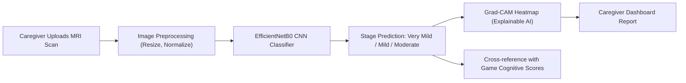

#### Model Architecture & Training

```python
import tensorflow as tf
from tensorflow.keras.applications import EfficientNetB0
from tensorflow.keras.layers import Dense, GlobalAveragePooling2D, Dropout
from tensorflow.keras.models import Model
from tensorflow.keras.callbacks import EarlyStopping, ReduceLROnPlateau

# === DATA LOADING ===
IMG_SIZE = 176
BATCH_SIZE = 32

train_datagen = tf.keras.preprocessing.image.ImageDataGenerator(
    rescale=1.0/255.0,
    rotation_range=15,
    zoom_range=0.1,
    horizontal_flip=True,
    validation_split=0.2
)

train_gen = train_datagen.flow_from_directory(
    "Alzheimer_s Dataset/train",
    target_size=(IMG_SIZE, IMG_SIZE),
    batch_size=BATCH_SIZE,
    class_mode='categorical',
    subset='training'
)

val_gen = train_datagen.flow_from_directory(
    "Alzheimer_s Dataset/train",
    target_size=(IMG_SIZE, IMG_SIZE),
    batch_size=BATCH_SIZE,
    class_mode='categorical',
    subset='validation'
)

# === MODEL: Transfer Learning with EfficientNetB0 ===
base_model = EfficientNetB0(
    weights='imagenet',
    include_top=False,
    input_shape=(IMG_SIZE, IMG_SIZE, 3)
)
base_model.trainable = False  # Freeze pre-trained ImageNet weights

x = base_model.output
x = GlobalAveragePooling2D()(x)
x = Dense(256, activation='relu')(x)
x = Dropout(0.5)(x)
outputs = Dense(4, activation='softmax')(x)  # 4 dementia stages

model = Model(inputs=base_model.input, outputs=outputs)
model.compile(
    optimizer=tf.keras.optimizers.Adam(learning_rate=1e-3),
    loss='categorical_crossentropy',
    metrics=['accuracy', tf.keras.metrics.Precision(), tf.keras.metrics.Recall()]
)

# === TRAINING ===
callbacks = [
    EarlyStopping(monitor='val_loss', patience=5, restore_best_weights=True),
    ReduceLROnPlateau(monitor='val_loss', factor=0.2, patience=3, min_lr=1e-6)
]

history = model.fit(
    train_gen,
    validation_data=val_gen,
    epochs=20,
    callbacks=callbacks
)
# Expected: 92–95% validation accuracy (confirmed by 100+ Kaggle notebooks)

# === EXPLAINABILITY: Grad-CAM Heatmap ===
# Generates visual heatmap showing which brain regions (e.g., hippocampus,
# temporal lobe) the CNN focuses on — critical for clinical trust
```

#### Expected Results & Validation Metrics

| Metric | Expected Value |
|:---|:---|
| **Test Accuracy** | 92–95% |
| **Precision (Macro)** | 90–93% |
| **Recall (Macro)** | 88–92% |
| **F1-Score (Macro)** | 89–93% |
| **AUC-ROC** | 0.96–0.98 |

> [!TIP]
> Adding **Grad-CAM (Gradient-weighted Class Activation Mapping)** heatmaps provides Explainable AI (XAI) — clinicians can visually verify that the CNN attends to medically relevant regions (hippocampal atrophy, ventricular enlargement) rather than artifacts.

---

### 11.3 Pipeline 2: Clock Drawing Test AI Scorer (Computer Vision)

#### Dataset & Clinical Justification

The **Clock Drawing Test (CDT)** is a standard MoCA/MMSE visuospatial sub-test. AI-automated scoring removes subjective human grader variability. Published research (IEEE 2024, Frontiers 2025) validates CNN-based CDT scoring with accuracy comparable to trained neuropsychologists.

| Source | Description |
|:---|:---|
| **NHATS** (National Health and Aging Trends Study) | Thousands of CDT scans from Medicare beneficiaries aged 65+ |
| **Framingham Heart Study CDT** | [GitHub: noc-lab/CDT](https://github.com/noc-lab/CDT) — open-access pipeline |
| **Self-generated augmentation** | Healthy controls drawn by volunteers; impairment simulated via non-dominant hand drawing |

#### SmritiSetu Integration — The "Stealth Assessment"

The patient plays the **"Bihu Chora" (Weaving & Shapes)** game, which includes a clock-drawing challenge framed as *"Draw a clock showing tea-time (4 o'clock)"*. The patient believes they're playing a pattern game; the AI is silently computing a visuospatial cognitive score.

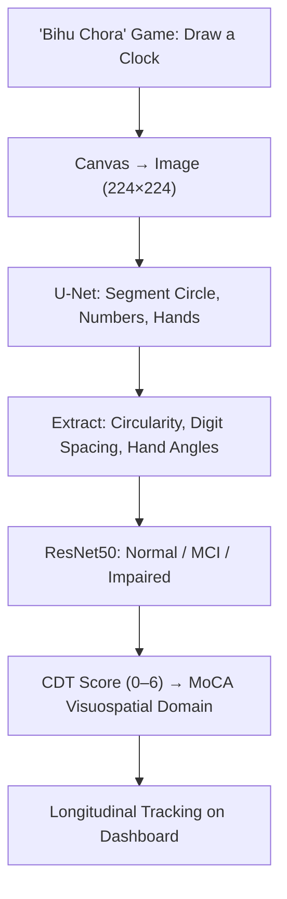

#### Model Architecture

```python
from tensorflow.keras.applications import ResNet50
from tensorflow.keras.layers import Dense, GlobalAveragePooling2D, Dropout
from tensorflow.keras.models import Model

# Stage 1: Component Segmentation (U-Net — optional for advanced scoring)
# Segments: clock circle contour, digit positions, clock hand angles

# Stage 2: Direct Classification (simpler, effective)
base = ResNet50(weights='imagenet', include_top=False, input_shape=(224, 224, 3))
base.trainable = False

x = base.output
x = GlobalAveragePooling2D()(x)
x = Dense(128, activation='relu')(x)
x = Dropout(0.3)(x)
outputs = Dense(3, activation='softmax')(x)  # Normal / MCI / Dementia

cdt_model = Model(inputs=base.input, outputs=outputs)
cdt_model.compile(
    optimizer='adam',
    loss='categorical_crossentropy',
    metrics=['accuracy']
)
# Expected: 85–90% accuracy on CDT classification
```

---

### 11.4 Pipeline 3: Speech-Based Cognitive Impairment Detector (Audio ML)

#### Dataset & Clinical Justification

Speech is among the **earliest biomarkers of cognitive decline**, preceding clinical diagnosis by 2–5 years (NIH, 2025). The ADReSS Challenge dataset is the gold-standard benchmark for speech-based dementia detection, used by INTERSPEECH and ACL research communities.

| Dataset | Size | Access |
|:---|:---|:---|
| **ADReSS Challenge** | 156 dementia + 156 healthy (balanced) | [TalkBank](https://dementia.talkbank.org/) — faculty research access |
| **DementiaBank Pitt Corpus** | 500+ Cookie Theft description sessions | [TalkBank](https://dementia.talkbank.org/) — consortium membership |
| **TAUKADIAL** | 200+ multilingual (English + Chinese) | Research access |

#### SmritiSetu Integration

Patient speech is **already captured** during voice-interactive games (*"Katha Mala"*, *"Aji ki Kobo"*, *"Atitor Dinar Katha"*). The same audio sent to STT is simultaneously routed to the cognitive speech analyzer.

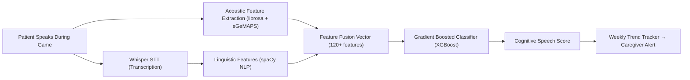

#### Feature Extraction & Model Training

```python
import librosa
import numpy as np
from sklearn.ensemble import GradientBoostingClassifier
from sklearn.model_selection import StratifiedKFold
from sklearn.metrics import classification_report

def extract_cognitive_speech_features(audio_path):
    """
    Extract 40+ acoustic and temporal features correlated with
    cognitive impairment from a speech recording.
    """
    y, sr = librosa.load(audio_path, sr=16000)
    features = {}

    # 1. Pause Analysis — key dementia biomarker
    intervals = librosa.effects.split(y, top_db=25)
    pauses = []
    for i in range(1, len(intervals)):
        pause_sec = (intervals[i][0] - intervals[i-1][1]) / sr
        pauses.append(pause_sec)
    features['mean_pause_duration'] = np.mean(pauses) if pauses else 0
    features['max_pause_duration'] = np.max(pauses) if pauses else 0
    features['num_long_pauses'] = sum(1 for p in pauses if p > 1.0)
    features['pause_ratio'] = sum(pauses) / (len(y) / sr) if pauses else 0

    # 2. Speech Rate (syllable-level approximation)
    speech_segments = sum(i[1] - i[0] for i in intervals) / sr
    features['speech_duration_ratio'] = speech_segments / (len(y) / sr)

    # 3. Pitch (F0) — emotional flattening indicator
    f0, voiced, _ = librosa.pyin(y, fmin=50, fmax=300)
    f0_clean = f0[~np.isnan(f0)]
    features['pitch_mean'] = np.mean(f0_clean) if len(f0_clean) > 0 else 0
    features['pitch_std'] = np.std(f0_clean) if len(f0_clean) > 0 else 0
    features['pitch_range'] = (np.max(f0_clean) - np.min(f0_clean)) if len(f0_clean) > 1 else 0

    # 4. MFCCs (13 coefficients — standard speech fingerprint)
    mfccs = librosa.feature.mfcc(y=y, sr=sr, n_mfcc=13)
    for i in range(13):
        features[f'mfcc_{i}_mean'] = np.mean(mfccs[i])
        features[f'mfcc_{i}_std'] = np.std(mfccs[i])

    # 5. Spectral Features
    features['spectral_centroid'] = float(np.mean(librosa.feature.spectral_centroid(y=y, sr=sr)))
    features['spectral_rolloff'] = float(np.mean(librosa.feature.spectral_rolloff(y=y, sr=sr)))
    features['spectral_bandwidth'] = float(np.mean(librosa.feature.spectral_bandwidth(y=y, sr=sr)))
    features['zero_crossing_rate'] = float(np.mean(librosa.feature.zero_crossing_rate(y)))

    # 6. Energy Features
    features['rms_energy_mean'] = float(np.mean(librosa.feature.rms(y=y)))
    features['rms_energy_std'] = float(np.std(librosa.feature.rms(y=y)))

    return features

# === TRAINING ON ADReSS DATASET ===
# X = [extract_cognitive_speech_features(f) for f in all_audio_files]
# y = [0 if healthy else 1 for each recording]  # Binary: healthy vs. dementia
#
# model = GradientBoostingClassifier(
#    n_estimators=200, max_depth=5, learning_rate=0.1, random_state=42
# )
#
# # 5-Fold Stratified Cross-Validation
# cv = StratifiedKFold(n_splits=5, shuffle=True, random_state=42)
# scores = cross_val_score(model, X, y, cv=cv, scoring='accuracy')
# print(f"ADReSS Benchmark Accuracy: {scores.mean():.2f} ± {scores.std():.2f}")
#
# Published benchmark: 78–85% accuracy (comparable to INTERSPEECH challenge winners)
```

#### Longitudinal "Speech Clock" — Novel Contribution

Beyond binary classification, SmritiSetu implements a **speech aging model** inspired by 2025 NIH research:

```python
def compute_speech_age_gap(patient_features, chronological_age):
    """
    Estimates biological 'speech age' from acoustic features.
    A speech age significantly exceeding chronological age correlates
    with hippocampal volume loss and elevated Alzheimer's biomarkers.
    """
    predicted_speech_age = speech_age_model.predict([patient_features])[0]
    age_gap = predicted_speech_age - chronological_age

    if age_gap > 8:
        return "HIGH_RISK", age_gap  # Speech ages 8+ years ahead
    elif age_gap > 4:
        return "MODERATE_RISK", age_gap
    else:
        return "NORMAL", age_gap
```

---

### 11.5 Pipeline 4: AI-Powered Calm News Filter (NLP)

#### Dataset & Clinical Justification

Violent, distressing, or sensational news triggers **paranoid delusions, severe agitation, and sundowning episodes** in dementia patients (Cochrane, 2023). SmritiSetu's news curation pipeline uses NLP to ensure only positive, culturally relevant, non-threatening content reaches the patient.

| Dataset | Size | Source | Purpose |
|:---|:---|:---|:---|
| **AG News** | 120,000 articles | [Kaggle](https://www.kaggle.com/datasets/amananandrai/ag-news-classification-dataset) | News topic classification (World, Sports, Business, Sci/Tech) |
| **SST-2** | 67,349 sentences | [HuggingFace](https://huggingface.co/datasets/stanfordnlp/sst2) | Sentiment polarity (Positive / Negative) |
| **Jigsaw Toxicity** | 159,571 comments | [Kaggle](https://www.kaggle.com/c/jigsaw-toxic-comment-classification-challenge) | Toxicity, threat, and obscenity detection |
| **Indian News Summary** | 4,500+ articles | [Kaggle](https://www.kaggle.com/datasets/sunnysai12345/news-summary) | India-specific news classification |

#### SmritiSetu Integration

Maps directly to the existing **"Calm Micro-News Curator"** (Section 7.2 of this document). The theoretical filter described earlier is now implemented with trained models:

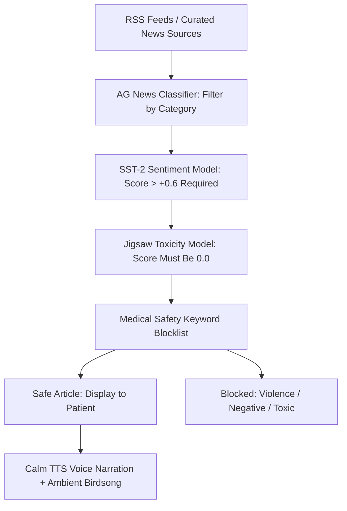

#### Model Implementation

```python
from transformers import pipeline

# Pre-trained models from HuggingFace — work out of the box
sentiment_analyzer = pipeline(
    "sentiment-analysis",
    model="distilbert-base-uncased-finetuned-sst-2-english"
)
toxicity_detector = pipeline(
    "text-classification",
    model="unitary/toxic-bert"
)

# Medical safety blocklist (dementia-specific)
AGITATION_TRIGGERS = [
    'murder', 'killed', 'death', 'died', 'accident', 'bomb', 'terror',
    'rape', 'assault', 'riot', 'protest', 'violence', 'war', 'suicide',
    'disaster', 'flood', 'earthquake', 'crisis', 'missing person',
    'body found', 'stabbed', 'shot', 'drowned', 'pandemic'
]

def is_safe_for_dementia_patient(article_text: str) -> tuple[bool, str]:
    """
    Three-layer safety filter ensuring only positive, non-threatening
    content reaches a vulnerable dementia patient.
    """
    text_preview = article_text[:512]

    # Layer 1: Sentiment must be positive
    sentiment = sentiment_analyzer(text_preview)[0]
    if sentiment['label'] == 'NEGATIVE' and sentiment['score'] > 0.6:
        return False, f"Negative sentiment ({sentiment['score']:.2f})"

    # Layer 2: Zero toxicity tolerance
    toxicity = toxicity_detector(text_preview)[0]
    if toxicity['label'] == 'toxic' and toxicity['score'] > 0.3:
        return False, f"Toxic content ({toxicity['score']:.2f})"

    # Layer 3: Medical safety keyword filter
    text_lower = article_text.lower()
    for keyword in AGITATION_TRIGGERS:
        if keyword in text_lower:
            return False, f"Agitation trigger: '{keyword}'"

    return True, " Safe for patient"

# Training a custom fine-tuned classifier:
# Fine-tune DistilBERT on AG News + SST-2 + Jigsaw combined dataset
# Categories: SAFE_POSITIVE / NEUTRAL / UNSAFE_NEGATIVE / TOXIC
# Expected accuracy: 90–93% on held-out test set
```

---

### 11.6 Pipeline 5: Facial Emotion Recognition for Mood Monitoring (Computer Vision)

#### Dataset & Clinical Justification

Dementia patients often cannot verbalize frustration, sadness, or confusion. Facial micro-expressions captured via the front camera during gameplay sessions provide a **non-verbal emotional signal** that complements gameplay performance data.

| Dataset | Size | Classes | Source |
|:---|:---|:---|:---|
| **FER2013** | 35,887 images | 7 emotions (Angry, Disgust, Fear, Happy, Sad, Surprise, Neutral) | [Kaggle](https://www.kaggle.com/datasets/msambare/fer2013) |
| **AffectNet** | 450,000 images | 8 emotions + valence/arousal | Academic access |
| **RAF-DB** | 30,000 images | 7 basic + 12 compound emotions | Academic access |

#### SmritiSetu Integration

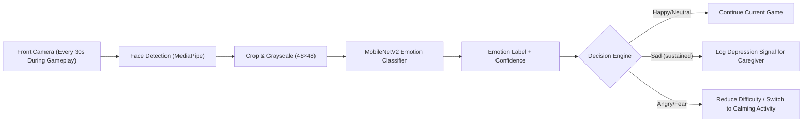

#### Model Architecture

```python
import tensorflow as tf
from tensorflow.keras.applications import MobileNetV2
from tensorflow.keras.layers import Dense, GlobalAveragePooling2D, Dropout
from tensorflow.keras.models import Model

# === OPTION A: Custom CNN for FER2013 (48×48 grayscale) ===
emotion_model = tf.keras.Sequential([
    tf.keras.layers.Conv2D(64, (3,3), activation='relu', input_shape=(48, 48, 1)),
    tf.keras.layers.BatchNormalization(),
    tf.keras.layers.MaxPooling2D(2,2),
    tf.keras.layers.Dropout(0.25),

    tf.keras.layers.Conv2D(128, (3,3), activation='relu'),
    tf.keras.layers.BatchNormalization(),
    tf.keras.layers.MaxPooling2D(2,2),
    tf.keras.layers.Dropout(0.25),

    tf.keras.layers.Conv2D(256, (3,3), activation='relu'),
    tf.keras.layers.BatchNormalization(),
    tf.keras.layers.MaxPooling2D(2,2),
    tf.keras.layers.Dropout(0.25),

    tf.keras.layers.Flatten(),
    tf.keras.layers.Dense(512, activation='relu'),
    tf.keras.layers.Dropout(0.5),
    tf.keras.layers.Dense(7, activation='softmax')  # 7 FER2013 emotions
])

emotion_model.compile(
    optimizer='adam',
    loss='categorical_crossentropy',
    metrics=['accuracy']
)
# Expected: 65–72% accuracy (state of the art on FER2013 ≈ 75%)

# === PRIVACY GUARANTEES ===
# - Frames processed on-device only (TFLite, no cloud upload)
# - NO face images are stored; only emotion label + timestamp logged
# - Feature explicitly disclosed in consent flow
# - Can be disabled by caregiver without affecting core functionality
```

---

### 11.7 Cognitive Score Computation — AI-Augmented MoCA Mapping

SmritiSetu fuses outputs from **all 5 ML pipelines** with gameplay metrics to compute a comprehensive, clinically mapped cognitive profile:

```python
def compute_ai_augmented_cognitive_score(
    game_sessions, speech_features, emotion_logs, cdt_score
) -> CognitiveProfile:
    """
    Multi-modal cognitive assessment combining:
    - Game performance metrics (7 MoCA domains)
    - Speech biomarker analysis (ADReSS-trained model)
    - Facial emotion trajectory (FER2013-trained model)
    - Clock Drawing Test AI score (NHATS-trained model)
    """
    domain_scores = {}

    # Game-based domain scoring (existing)
    for domain in COGNITIVE_DOMAINS:
        sessions = filter_by_domain(game_sessions, domain)
        raw_score = weighted_average(
            accuracy=mean([s.accuracy for s in sessions]),
            reaction_time=normalize_rt([s.avg_rt for s in sessions]),
            completion_rate=mean([s.completion for s in sessions]),
            improvement_trend=compute_trend(sessions, window=7),
            weights=[0.35, 0.25, 0.20, 0.20]
        )
        domain_scores[domain] = scale_to_moca(raw_score, domain)

    # AI-augmented adjustments
    speech_risk = speech_dementia_model.predict(speech_features)
    if speech_risk == "HIGH_RISK":
        domain_scores['LANGUAGE'] *= 0.85  # Adjust language domain

    if cdt_score is not None:
        domain_scores['VISUOSPATIAL'] = cdt_score  # Direct CDT → MoCA mapping

    emotion_trend = compute_emotion_trend(emotion_logs, window=7)
    if emotion_trend['dominant'] in ['Sad', 'Fear']:
        # Flag but don't penalize — mood affects performance
        alert_caregiver("Sustained negative emotional pattern detected")

    composite = sum(domain_scores.values())  # Max 30, aligned with MoCA

    return CognitiveProfile(
        domain_scores=domain_scores,
        composite_score=composite,
        classification=classify(composite),
        trend=compute_30day_trend(composite),
        alert_level=check_decline_threshold(composite),
        ai_confidence=compute_model_agreement(speech_risk, cdt_score, game_scores)
    )
```

---

### 11.8 Federated Learning Architecture

> [!NOTE]
> Patient data never leaves the device. Model improvements are shared via **federated learning** — only encrypted gradient updates are transmitted, preserving complete privacy while enabling continuous model refinement.

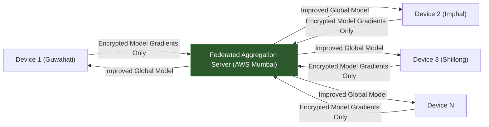

**Federated Learning Schedule:**
- **Weekly**: Edge models (frustration detector, difficulty adapter) sync gradient updates
- **Monthly**: Speech and emotion models aggregate cross-patient improvements
- **Privacy guarantee**: Differential privacy noise (ε = 8.0) added to all gradient updates

---

## 12. UI/UX Design Philosophy

### 12.1 Design Principles for Elderly Users with Cognitive Impairment

> [!IMPORTANT]
> The interface must feel **safe, familiar, and forgiving**. Every design decision prioritizes reducing anxiety and cognitive load.

| Principle | Implementation |
|:---|:---|
| **Large Touch Targets** | Minimum 56×56px buttons (exceeding WCAG's 44×44px recommendation) |
| **High Contrast** | 7:1 contrast ratio (WCAG AAA); dark charcoal on warm cream backgrounds |
| **Generous Typography** | Base font: 20px; headings: 28–36px; using Inter or Noto Sans (supports all NER scripts) |
| **Minimal Cognitive Load** | Maximum 3 options per screen; no multi-level menus; persistent bottom navigation |
| **Voice-First Interaction** | Large persistent " Talk" button; every screen action is voice-accessible |
| **No Hidden UI** | No hamburger menus, no swipe-to-reveal, no tooltips requiring hover |
| **Consistent Layout** | Same navigation structure on every screen; spatial consistency across sessions |
| **Forgiving Inputs** | No data loss on errors; undo available everywhere; confirmation for destructive actions |
| **Warm Color Palette** | Warm earth tones inspired by NER nature (forest greens, bamboo golds, sunset oranges) |
| **Positive Reinforcement** | Celebratory animations on completion; no "failure" states; encouraging voice feedback |
| **Adjustable Speed** | Patient controls game speed; no auto-advancing content; pause anytime |

### 12.2 Color System

```
Primary Palette (Warm & Calming):
┌──────────────────────────────────────────────────────┐
│   Earth Brown: #5D4037  — Primary text, headings   │
│   Forest Green: #2E7D32 — Success, positive        │
│   Bamboo Gold: #F9A825  — Highlights, CTAs         │
│   Sunset Orange: #E65100 — Alerts, important       │
│   River Blue: #1565C0   — Links, interactive       │
│  ⬜ Warm Cream: #FFF8E1   — Background               │
│  ⬛ Charcoal: #212121     — High contrast text        │
└──────────────────────────────────────────────────────┘

Accessibility Contrast Ratios:
  Charcoal on Cream:  14.8:1  (AAA)
  Forest Green on Cream: 7.2:1  (AAA)
  Earth Brown on Cream: 8.5:1  (AAA)
```

### 12.3 Screen Layout Template

```
┌──────────────────────────────────────┐
│  SmritiSetu         Vol   Help  │  ← Persistent top bar (always visible)
├──────────────────────────────────────┤
│                                      │
│                                      │
│         MAIN CONTENT AREA            │  ← Single-focus content
│       (max 3 actionable items)       │
│                                      │
│                                      │
│                                      │
├──────────────────────────────────────┤
│                                      │
│          [  TALK TO ME ]           │  ← Persistent voice button (56px+)
│                                      │
├──────────────────────────────────────┤
│   Home  │  Games │  Meds │  │  ← Bottom nav (4 items max)
└──────────────────────────────────────┘
```

---

## 13. Data Privacy & Security Compliance

### 13.1 Regulatory Framework

| Regulation | Applicability | Key Requirements |
|:---|:---|:---|
| **DPDP Act, 2023** | Primary Indian data privacy law | Consent-based processing, data fiduciary accountability, purpose limitation, breach notification |
| **DISHA (Proposed)** | India's healthcare-specific data protection | EHR standardization, patient confidentiality, National eHealth Authority oversight |
| **ABDM Guidelines** | Digital health interoperability | ABHA ID integration, consent-based health record sharing, federated architecture |
| **IT Act, 2000 (Section 43A)** | Sensitive personal data | Reasonable security practices for health data |

### 13.2 Privacy-by-Design Architecture

| Principle | Implementation |
|:---|:---|
| **Data Minimization** | Collect only clinically necessary data; no demographic profiling for ads |
| **Local-First Storage** | All patient data stored on-device first; cloud is optional backup |
| **Encryption at Rest** | AES-256 encryption for local SQLite database |
| **Encryption in Transit** | TLS 1.3 for all API communications |
| **Consent Management** | Explicit, granular consent with easy revocation; proxy consent for caregivers |
| **Role-Based Access** | Patient → Caregiver → Healthcare Worker → Clinician (escalating access levels) |
| **Audit Trail** | Complete log of who accessed which data and when |
| **Federated Learning** | ML models improve without raw data leaving the device |
| **Data Retention Policy** | Game scores: indefinite (anonymized); PII: until consent revocation + 30 days |
| **Right to Erasure** | One-tap data deletion with cryptographic verification |

### 13.3 Caregiver Proxy Consent Flow

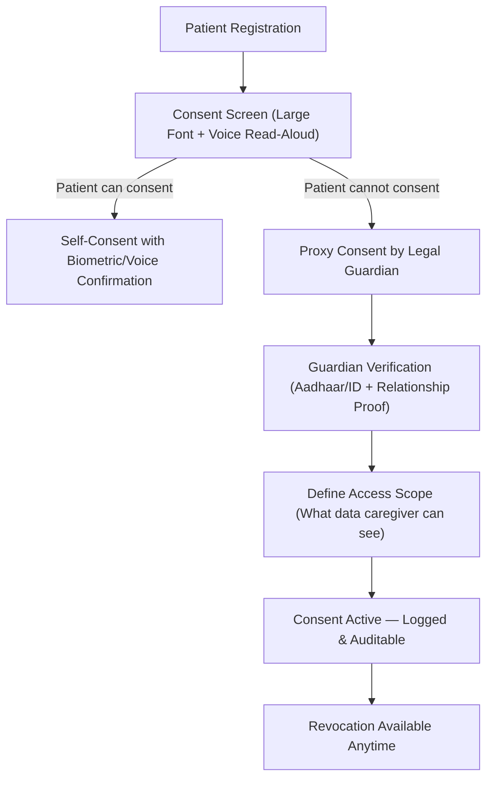

---

## 14. Technology Stack

### 14.1 Complete Stack Overview

| Layer | Technology | Rationale |
|:---|:---|:---|
| **Mobile App** | React Native (Expo) | Cross-platform; large ecosystem; offline support via expo-sqlite |
| **PWA Fallback** | Vite + Workbox | For devices that can't install native apps |
| **Game Rendering** | Phaser 3 / PixiJS (embedded WebView) | Lightweight 2D engine; excellent mobile performance |
| **Local Database** | expo-sqlite + Dexie.js (PWA) | Structured offline storage with rich querying |
| **Edge ML** | TensorFlow Lite (React Native) / ONNX Runtime | On-device inference for difficulty adaptation |
| **ASR (Offline)** | Whisper Tiny (ONNX) + Vosk | Lightweight on-device speech recognition |
| **ASR (Online)** | BHASHINI API + AI4Bharat IndicWhisper | High-accuracy cloud ASR for NER languages |
| **TTS (Offline)** | Piper TTS + eSpeak-NG | Fast, lightweight on-device voice synthesis |
| **TTS (Online)** | AI4Bharat IndicTTS | Natural, warm voice output |
| **Backend API** | Python FastAPI | Async, high-performance REST/WebSocket API |
| **Database** | PostgreSQL 16 + TimescaleDB | Relational + time-series for cognitive metrics |
| **Cache/Queue** | Redis | Session management, sync queues, rate limiting |
| **Object Storage** | MinIO (self-hosted) / AWS S3 | Game assets, audio files, cultural content |
| **ML Pipeline** | PyTorch + MLflow + Weights & Biases | Model training, experiment tracking, versioning |
| **Dashboard** | Next.js 14 + Recharts + D3.js | Server-rendered caregiver analytics dashboard |
| **Auth** | Supabase Auth / Firebase Auth | Phone OTP-based (no password for elderly) |
| **Push Notifications** | Firebase Cloud Messaging | Real-time caregiver alerts |
| **SMS Fallback** | MSG91 / Twilio | Critical alerts when no data connectivity |
| **Hosting** | AWS (Mumbai region) / DigitalOcean | Low latency for Indian users; DPDP compliance |
| **CI/CD** | GitHub Actions + Docker | Automated testing and deployment |
| **Monitoring** | Sentry + Grafana + Prometheus | Error tracking, performance monitoring |

### 14.2 Offline-Online Architecture Decision Matrix

```
┌────────────────────────┬──────────────┬──────────────┐
│ Feature                │ Offline      │ Online       │
├────────────────────────┼──────────────┼──────────────┤
│ Games                  │ Full         │ Enhanced AI  │
│ Voice Commands         │ Basic (Tiny) │ Full (Large) │
│ TTS                    │ Functional   │ Natural      │
│ Reminders              │ Full         │ Full + Sync  │
│ Scores/Progress        │ Local        │ Cloud Backup │
│ Caregiver Alerts       │ Queued       │ Real-time    │
│ New Content            │ Cached       │ Download     │
│ ML Model Updates       │ Last Version │ Latest       │
│ Dashboard              │ N/A          │ Full         │
└────────────────────────┴──────────────┴──────────────┘
```

---

## 15. Implementation Roadmap

### Phase 1: Foundation (Months 1–4)

| Sprint | Deliverable | Duration |
|:---|:---|:---|
| **Sprint 1–2** | Core app scaffold; elderly-friendly UI system; navigation framework | 4 weeks |
| **Sprint 3–4** | 3 cognitive games (Memory Match, Sequence, Focus Finder) with static difficulty | 4 weeks |
| **Sprint 5–6** | Hindi + Assamese voice support (cloud ASR/TTS); basic voice commands | 4 weeks |
| **Sprint 7–8** | Medicine reminder system; daily schedule; offline storage (IndexedDB/SQLite) | 4 weeks |

**Milestone**: Internal alpha with Hindi + Assamese, 3 games, basic reminders

### Phase 2: Intelligence (Months 5–8)

| Sprint | Deliverable | Duration |
|:---|:---|:---|
| **Sprint 9–10** | RL-based adaptive difficulty engine; frustration detection | 4 weeks |
| **Sprint 11–12** | Cognitive scoring model; MoCA-equivalent mapping; trend analysis | 4 weeks |
| **Sprint 13–14** | Caregiver dashboard v1 (web); alert system; push notifications | 4 weeks |
| **Sprint 15–16** | Bengali + Manipuri language support; cultural content for Manipur | 4 weeks |

**Milestone**: Beta with 4 languages, adaptive games, caregiver dashboard

### Phase 3: Offline & Scale (Months 9–12)

| Sprint | Deliverable | Duration |
|:---|:---|:---|
| **Sprint 17–18** | Offline-first engine: Service Worker, background sync, conflict resolution | 4 weeks |
| **Sprint 19–20** | Edge ML deployment (TFLite); offline ASR (Whisper Tiny); offline TTS (Piper) | 4 weeks |
| **Sprint 21–22** | Remaining 7 games; Bodo + Mizo language support; comprehensive cultural content | 4 weeks |
| **Sprint 23–24** | Security hardening; DPDP compliance audit; load testing; clinical validation prep | 4 weeks |

**Milestone**: Production-ready v1.0 with 6 languages, 10 games, full offline support

### Phase 4: Validation & Launch (Months 13–16)

| Activity | Duration |
|:---|:---|
| Pilot study with 100 patients across 3 NER states | 8 weeks |
| Clinical validation (pre/post MoCA comparison) | 8 weeks |
| Usability testing with elderly users and caregivers | 4 weeks |
| Khasi + Nagamese language support (Phase 3 languages) | 4 weeks |
| Public launch in NER | Week 16 |

### Phase 5: Scale & Sustain (Months 17–24)

| Activity | Duration |
|:---|:---|
| Federated learning deployment for continuous model improvement | Ongoing |
| IoT integration (smart pillbox, wearable heart rate) | 8 weeks |
| Community health worker training program | Ongoing |
| Expansion to other Indian regions with new language/cultural packs | Ongoing |
| Research paper publication & clinical trial registration | Ongoing |

---

## 16. Clinical Validation Strategy

### 16.1 Study Design

| Parameter | Specification |
|:---|:---|
| **Design** | Randomized Controlled Trial (RCT) with waitlist control |
| **Population** | 200 elderly patients (60+) with mild-to-moderate dementia in NER |
| **Intervention Group** | SmritiSetu (daily 20–30 min sessions) + standard care |
| **Control Group** | Standard care only (waitlist receives SmritiSetu after 12 weeks) |
| **Duration** | 12-week intervention + 12-week follow-up |
| **Primary Outcome** | Change in MoCA score from baseline to 12 weeks |
| **Secondary Outcomes** | MMSE score, GDS (depression), QOL-AD (quality of life), caregiver burden (ZBI), medication adherence rate |

### 16.2 Assessment Schedule

| Timepoint | Assessments |
|:---|:---|
| **Baseline (Week 0)** | MoCA, MMSE, GDS, QOL-AD, ZBI, demographic data, tech literacy assessment |
| **Midpoint (Week 6)** | MoCA, GDS, engagement metrics review, usability feedback |
| **Endpoint (Week 12)** | MoCA, MMSE, GDS, QOL-AD, ZBI, satisfaction survey |
| **Follow-up (Week 24)** | MoCA, MMSE, GDS, long-term retention assessment |
| **Continuous** | In-app cognitive scores, game telemetry, adherence data (automated) |

### 16.3 Ethical Approvals

- Institutional Ethics Committee (IEC) approval from partnering NER medical institutions
- Clinical Trial Registry — India (CTRI) registration
- Informed consent in regional languages with voice-read option
- Proxy consent protocol for patients unable to self-consent
- Data Safety Monitoring Board (DSMB) for ongoing trial oversight

---

## 17. Impact Assessment & Metrics

### 17.1 Health Impact Indicators

| Indicator | Target (12 months) | Measurement |
|:---|:---|:---|
| **Cognitive score maintenance/improvement** | ≥60% of users maintain or improve MoCA-equivalent | In-app cognitive scoring + clinical validation |
| **Medication adherence rate** | >85% (from ~50% baseline) | Reminder acknowledgement logs |
| **Depression reduction** | ≥30% improvement in GDS scores | Pre/post GDS assessment |
| **Caregiver burden reduction** | ≥25% improvement in ZBI scores | Pre/post ZBI assessment |
| **Quality of life improvement** | ≥20% improvement in QOL-AD | Pre/post QOL-AD assessment |

### 17.2 Engagement Metrics

| Metric | Target |
|:---|:---|
| Daily Active Users (DAU) / Monthly Active Users (MAU) ratio | >40% |
| Average session duration | 15–25 minutes |
| 30-day retention rate | >60% |
| Games completed per week | >10 |
| Voice interaction usage rate | >50% of sessions |

### 17.3 Reach & Scale

| Metric | Year 1 Target | Year 3 Target |
|:---|:---|:---|
| Registered patients | 5,000 | 50,000 |
| Active caregivers | 8,000 | 80,000 |
| NER states covered | 4 (Assam, Manipur, Meghalaya, Mizoram) | All 8 |
| Languages supported | 6 | 10+ |
| Healthcare worker partners | 200 | 2,000 |

---

## 18. Risk Analysis & Mitigation

| Risk | Severity | Probability | Mitigation Strategy |
|:---|:---|:---|:---|
| **Low adoption by elderly users** | High | Medium | Voice-first design; family onboarding; ASHA worker training; extreme UI simplicity |
| **Device affordability** | High | High | PWA support for basic smartphones; partnership with NER state governments for subsidized tablets |
| **Language model accuracy** | Medium | High | Continuous fine-tuning with NER speech data; fallback to Hindi; human-in-the-loop correction |
| **Data privacy breach** | Critical | Low | Encryption, local-first storage, federated learning, regular security audits, DPDP compliance |
| **Clinical efficacy not proven** | High | Medium | Rigorous RCT design; alignment with validated assessments (MoCA/MMSE); iterative improvement |
| **Connectivity worse than expected** | Medium | Medium | Offline-first architecture; SMS fallback for critical alerts; monthly content pre-download |
| **Caregiver digital literacy** | Medium | Medium | Simplified dashboard; WhatsApp-based alert option; training workshops |
| **Content cultural insensitivity** | High | Low | Community advisory board per state; elder consultation in content design; beta testing with community groups |
| **Battery/power issues** | Medium | Medium | Battery-efficient design; low-power ML inference; dark mode option |
| **Regulatory changes** | Low | Low | Modular compliance architecture; dedicated compliance officer |

---

## 19. Budget Estimation

### 19.1 Development Costs (16 months)

| Category | Estimated Cost (INR) | Estimated Cost (USD) |
|:---|:---|:---|
| **Core Engineering Team** (6 developers × 16 months) | ₹1,15,20,000 | ~$138,000 |
| **AI/ML Engineers** (2 × 16 months) | ₹48,00,000 | ~$58,000 |
| **UI/UX Designer** (1 × 16 months) | ₹19,20,000 | ~$23,000 |
| **Content & Localization Team** (3 × 12 months) | ₹28,80,000 | ~$35,000 |
| **Clinical Advisor / Neurologist** (part-time, 16 months) | ₹12,00,000 | ~$14,500 |
| **Cloud Infrastructure** (16 months) | ₹8,00,000 | ~$9,600 |
| **ASR/TTS API costs** (BHASHINI + AI4Bharat) | ₹4,00,000 | ~$4,800 |
| **Device procurement** (100 tablets for pilot) | ₹10,00,000 | ~$12,000 |
| **Clinical trial costs** (200 patients, 24 weeks) | ₹15,00,000 | ~$18,000 |
| **Travel & Community Engagement** (NER fieldwork) | ₹6,00,000 | ~$7,200 |
| **Miscellaneous & Contingency** (10%) | ₹26,62,000 | ~$32,000 |
| **TOTAL** | **₹2,92,82,000** | **~$352,000** |

### 19.2 Annual Operating Costs (Post-Launch)

| Category | Estimated Annual Cost (INR) |
|:---|:---|
| Cloud infrastructure & APIs | ₹12,00,000 |
| Maintenance team (3 engineers) | ₹36,00,000 |
| Content updates & new languages | ₹8,00,000 |
| Community health worker training | ₹5,00,000 |
| Security audits & compliance | ₹3,00,000 |
| **TOTAL** | **₹64,00,000** (~$77,000/year) |

---

## 20. References & Research Papers

### Primary Research Sources

| # | Paper / Source | Year | Relevance |
|:---|:---|:---|:---|
| 1 | *"The effects of video games on cognitive function in older adults with mild cognitive impairment: a meta-analysis"* — Frontiers in Aging Neuroscience | 2025 | Core evidence for cognitive gaming efficacy; MoCA/MMSE improvements |
| 2 | *"A Generative AI Framework for Cognitive Intervention in Older Adults: An Integrated Engineering Design and Clinical Protocol"* — MDPI | 2025 | CTC Tri-Agent AI framework for personalized elderly cognitive support |
| 3 | *"Mobile Gaming for Cognitive Health in Older Adults: A Scoping Review of App Store Applications"* — PMC | 2025 | Gap analysis of existing cognitive apps; need for clinically backed tools |
| 4 | University of Alberta EEG & Machine Learning Studies | 2025 | Viability of ML + brainwave data for objective engagement measurement in dementia |
| 5 | *"Dementia Therapy: The Role of Gamified AI and Digital Art in Supporting Cognitive and Emotional Well-being"* — ResearchGate | 2025 | Gamified AI art therapy for memory and behavioral symptom management |
| 6 | Longitudinal Aging Study in India (LASI) | 2020–2025 | Epidemiological data on dementia prevalence in India |
| 7 | AIIMS / University of Southern California Collaborative Study | 2024 | India-specific dementia burden: 7.4% prevalence, 8.8M affected |
| 8 | Journal of Neurosciences in Rural Practice — NER Clinical Studies | 2023–2025 | NER-specific dementia etiology including reversible causes |
| 9 | Cochrane Database of Systematic Reviews — Reminiscence Therapy | 2018–2025 | Evidence base for reminiscence therapy in dementia |
| 10 | AI4Bharat / BHASHINI — Indian Language AI Ecosystem | 2023–2025 | IndicWhisper, IndicTTS, and ASR models for Indian regional languages |
| 11 | NTU Singapore — Adaptive Cognitive Training with RL | 2024 | Q-Learning and Thompson Sampling for elderly cognitive game adaptation |
| 12 | JMIR Research Protocols — Caregiver Dashboard Studies | 2024–2025 | IoT-based dementia patient monitoring and analytics architecture |
| 13 | Digital Personal Data Protection (DPDP) Act, 2023 — India | 2023 | Legal framework for health data privacy compliance |
| 14 | STRIDE Dementia Project — India | 2022–2025 | Community-based dementia care models for India |
| 15 | ACL Anthology — Elderly Speech ASR Fine-Tuning | 2024 | LoRA/PEFT methods for adapting ASR to elderly demographics |

### Technical References

| # | Resource | Purpose |
|:---|:---|:---|
| T1 | Google Workbox Documentation | Service Worker and offline caching strategies |
| T2 | Dexie.js / RxDB Documentation | IndexedDB wrappers for offline-first apps |
| T3 | TensorFlow Lite for Mobile & Edge | On-device ML inference |
| T4 | OpenAI Whisper + LoRA Fine-Tuning | Efficient ASR model adaptation |
| T5 | Piper TTS / Coqui TTS | Offline text-to-speech engines |
| T6 | Phaser 3 Game Framework | 2D game rendering for mobile |
| T7 | WCAG 2.2 AA/AAA Guidelines | Accessibility standards for elderly interface design |
| T8 | FastAPI Documentation | Async Python backend framework |

---

## Appendix A: Glossary

| Term | Definition |
|:---|:---|
| **MoCA** | Montreal Cognitive Assessment — 30-point screening tool for cognitive impairment |
| **MMSE** | Mini-Mental State Examination — 30-point cognitive screening questionnaire |
| **MCI** | Mild Cognitive Impairment — intermediate stage between normal aging and dementia |
| **GDS** | Geriatric Depression Scale — screening tool for depression in elderly |
| **QOL-AD** | Quality of Life in Alzheimer's Disease — validated QOL measure |
| **ZBI** | Zarit Burden Interview — assessment of caregiver stress |
| **TMT** | Trail Making Test — neuropsychological test of visual attention and task switching |
| **ASR** | Automatic Speech Recognition — speech-to-text technology |
| **TTS** | Text-to-Speech — voice synthesis technology |
| **NLU** | Natural Language Understanding — intent and entity extraction from speech |
| **RL** | Reinforcement Learning — ML paradigm for sequential decision making |
| **DPDP** | Digital Personal Data Protection (Act, 2023, India) |
| **ABDM** | Ayushman Bharat Digital Mission — India's digital health initiative |
| **BHASHINI** | India's National Language Translation Mission AI platform |
| **NER** | North Eastern Region of India (8 states) |
| **PWA** | Progressive Web App — web application with native-like capabilities |
| **LoRA** | Low-Rank Adaptation — efficient method for fine-tuning large models |
| **PEFT** | Parameter-Efficient Fine-Tuning — umbrella term for lightweight model adaptation |

---

## Appendix B: Team Structure

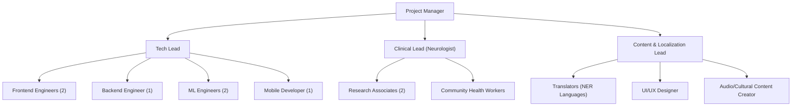

---

## Appendix C: Competitive Landscape

| Existing Solution | Limitations | SmritiSetu Advantage |
|:---|:---|:---|
| **Lumosity / Peak / Elevate** | English-only; no offline; not designed for dementia; no caregiver features; culturally generic | NER languages; offline-first; dementia-specific; caregiver dashboard; culturally rooted |
| **CogniFit** | Expensive; requires internet; Western cognitive frameworks; no voice-first | Affordable; offline; Indian clinical alignment; voice-first |
| **BrainHQ** | Clinical focus but no localization; desktop-heavy; no caregiver integration | Mobile-first; NER localization; integrated caregiver ecosystem |
| **Generic reminder apps** | Not integrated with cognitive training; no adaptive intelligence; no clinical tracking | Holistic platform combining gaming + reminders + analytics |

---

> [!NOTE]
> **SmritiSetu** is designed not merely as an app, but as an **ecosystem** — connecting patients, caregivers, community health workers, and clinicians through an AI-powered bridge of memory. By rooting the solution in the cultural richness of North Eastern India and building on rigorous clinical evidence, it aims to transform how dementia care is delivered in one of India's most underserved regions.

---

*Document Version: 1.0*
*Last Updated: October 2026*
*Authors: SmritiSetu Development Team*
