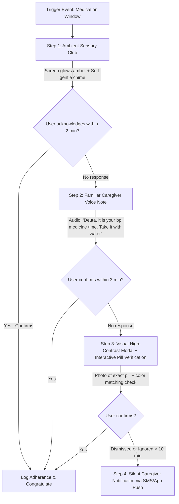
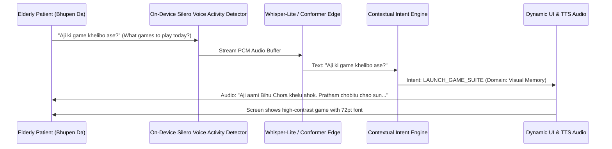

# SmritiSetu (स्मृतिसेतु) — Comprehensive Feature Architecture & Clinical Implementation Blueprint

---

## 1. Executive Summary & Core Feature Ecosystem

**SmritiSetu** is an offline-first, culturally anchored cognitive health and assistive companion engineered specifically for elderly individuals experiencing Mild Cognitive Impairment (MCI) and early-to-moderate dementia in the North Eastern Region (NER) and rural/semi-urban India.

Based on core geriatric neurology principles, dementia care requires a triad: **Cognitive Stimulation**, **Adaptive Daily Scaffolding**, and **Caregiver Safety Netting**.

```
                               ┌──────────────────────────────────────────────────────────┐
                               │                 SMRITISETU CORE ECOSYSTEM                 │
                               └──────────────────────────┬───────────────────────────────┘
                                                          │
          ┌──────────────────────────┬────────────────────┴───────────────┬──────────────────────────┐
          │                          │                                    │                          │
          ▼                          ▼                                    ▼                          ▼
┌──────────────────┐       ┌──────────────────┐                 ┌──────────────────┐       ┌──────────────────┐
│ Clinical Games   │       │ Adaptive Smart   │                 │ Caregiver Vault  │       │ Offline Spatial  │
│ (MoCA / MMSE)    │       │ Reminders        │                 │ & Emergency Card │       │ Wayfinding       │
│ - 7 Core Domains │       │ - RL Time Learn  │                 │ - Allergy Matrix │       │ - Photo-Landmark │
│ - NER Motifs     │       │ - Voice Escalator│                 │ - SOS One-Touch  │       │ - Safe Geofence  │
│ - Auto-Calibrate │       │ - Circadian Sync │                 │ - Medical Binder │       │ - Route Vectors  │
└─────────┬────────┘       └─────────┬────────┘                 └─────────┬────────┘       └─────────┬────────┘
          │                          │                                    │                          │
          └──────────────────────────┼────────────────────────────────────┴──────────────────────────┘
                                     │
          ┌──────────────────────────┴────────────────────────────────────┐
          │                                                               │
          ▼                                                               ▼
┌──────────────────────────────────┐                            ┌──────────────────────────────────┐
│ Reminiscence Memory Engine       │                            │ Grounding & Calm Micro-News      │
│ - Caregiver Curated Milestone Qs │                            │ - Daily Orientation (CM, Police) │
│ - Photo-Narrative Guessing       │                            │ - Non-Agitating Uplifting Feed   │
│ - Regional Sensory Audio Cues    │                            │ - Local Haat/Weather/Festivals   │
└──────────────────────────────────┘                            └──────────────────────────────────┘
                                     ▲
                                     │
                     ┌───────────────┴───────────────┐
                     │ Voice-First Multilingual Nav  │
                     │ - STT/TTS (Assamese/Hindi/etc)│
                     │ - Zero-Touch High-Contrast UI │
                     └───────────────────────────────┘
```

---

## 2. Feature 1: Clinical Cognitive Games Engine (MoCA & MMSE Aligned)

### 2.1 Clinical Diagnostic Foundation
Traditional mobile brain games lack standardized validation and cultural familiarity. SmritiSetu maps every interactive exercise directly to the sub-tests of the **Montreal Cognitive Assessment (MoCA)** and the **Mini-Mental State Examination (MMSE)**:

| Clinical Domain | MoCA Sub-test Reference | MMSE Equivalent | SmritiSetu Game Module | NER Cultural Customization |
| :--- | :--- | :--- | :--- | :--- |
| **Visuospatial / Executive** | Clock Drawing, Trail Making B, Cube Copy | Intersecting Pentagons | **"Bihu Chora" (Weaving & Shapes)** / **"Pahadi Rasta" (Trail Connector)** | Connecting numbered tea leaves; traditional bamboo basket weaving grid patterns |
| **Naming & Semantic Memory** | Animal Naming (Lion, Rhino, Camel) | Object Naming (Watch, Pen) | **"Chine Ne?" (Do You Recognize?)** | One-horned Rhinoceros, Hornbill, Eri Silk Moth, River Dolphin, traditional Dhol/Pepa |
| **Attention & Concentration** | Forward/Backward Digit Span, Vigilance Tapping | Serial 7s Subtraction, Spell "WORLD" backwards | **"Taal Milan" (Rhythm Tap)** / **"Bajaar Hisaab" (Market Coins)** | Tapping screen only when a specific drumbeat (Khol/Dhol) sounds; calculating change in Rupees at weekly bazaar |
| **Language & Fluency** | Sentence Repetition, Phonemic Fluency | 3-stage command, reading/writing | **"Katha Mala" (Word Garland)** / **"Aji ki Kobo" (Proverb Match)** | Assamese/Bengali/Hindi proverbs; naming local indigenous vegetables/fruits (Kaji Nemu, Ou Tenga) |
| **Abstraction & Reasoning** | Train-Bicycle, Watch-Ruler relationships | Similarities | **"Mel-Khuwa" (Odd One Out)** | Classifying river fish vs. pond fish, harvest tools vs. kitchen utensils |
| **Delayed Recall & Working Memory** | 5-word delayed recall with category/multiple-choice cues | 3-word registration & recall | **"Punar Smriti" (Recall the Pantry)** | Remembering 5 items kept in the "Bhoral" (granary) after a 5-minute distractor game |
| **Temporal & Spatial Orientation** | Date, Month, Year, Day, Place, City | Year, Season, Date, Hospital, Floor | **"Dinar Disha" (Day & Compass)** | Identifying morning vs. evening tea time, seasonal Bihu (Rongali, Kongali, Bhogali), local district |

---

### 2.2 Gameplay Mechanics & Mathematical Progression

#### A. "Pahadi Rasta" (Trail Making & Executive Alternation)
- **Objective**: Player connects alternating numbers and letters or regional characters ($1 \to A \to 2 \to B \to 3 \to C$ or $1 \to \text{ক} \to 2 \to \text{খ}$).
- **Motor Adaptation**: Generous target radius (touch target $\ge 64\text{dp}$) with magnetic snap-to-target to compensate for senile tremors and Parkinsonian motor deficits.
- **Scoring Function**:
  $$\text{Score}_{\text{trail}} = \max\left(0, 100 \times \left(1 - \frac{T_{\text{completion}} - T_{\text{baseline}}}{T_{\text{max}}}\right) - 15 \times N_{\text{errors}}\right)$$

#### B. "Bajaar Hisaab" (Attention & Serial Calculation)
- **Objective**: Simulates buying essentials at a local weekly market (*Haat*).
- **Levels**:
  - *Tier 1 (Mild MCI)*: Simple coin additions ($10 + 5 + 20$).
  - *Tier 2 (Moderate)*: Making change from ₹50 or ₹100 note.
  - *Tier 3 (Clinical MMSE Serial 7s)*: Counting down basket weights by 7 kg steps with visual feedback.

#### C. Automated Difficulty Calibration (Bayesian Dynamic Difficulty Adjustment - BDDA)
Rather than simple score thresholds, difficulty scales along a latent cognitive proficiency parameter $\theta \in [-3.0, +3.0]$ using an Item Response Theory (IRT) 2-parameter logistic model:

$$P(\text{Correct} \mid \theta, a_i, b_i) = \frac{1}{1 + e^{-a_i (\theta - b_i)}}$$

Where:
- $\theta$: Current estimated cognitive capacity of the patient.
- $a_i$: Discrimination factor of game level $i$.
- $b_i$: Clinical difficulty index of game level $i$.

If player experiences continuous errors, the game drops $b_i$ and introduces positive reinforcement audio ("Bahut bhal chesta!", "Bahut sundar!") to eliminate frustration and catastrophic emotional reactions.

---

## 3. Feature 2: Smart Adaptive Reminders (AI Habit & Circadian Learning)

### 3.1 The Failure of Static Reminders in Dementia
Static alarms fail dementia patients because:
1. Alarms sound when the user is disoriented, asleep, or in the bathroom, leading to dismissal and forgetting.
2. Repetitive robotic beeps trigger auditory agnosia, confusion, or agitation.
3. If an alarm is dismissed without actual medication ingestion, neither the patient nor the remote caregiver knows.

---

### 3.2 The SmritiSetu Adaptive Learning Architecture

SmritiSetu uses an on-device contextual multi-armed bandit (MAB) with LinUCB to learn the patient’s individual responsiveness profile:

```
[Context Vector x_t]
  ├── Time of Day (sin/cos encoding)
  ├── Accelerometer Motion State (Resting, Walking, Active)
  ├── Time elapsed since last meal/activity
  ├── Ambient Light Sensor (Daylight vs. Dark Room)
  ├── Past Game Alertness Score of the Day
  └── Historical Response Latency (Moving Average)
                          │
                          ▼
            [LinUCB Contextual Engine]
                          │
         ┌────────────────┴────────────────┐
         ▼                                 ▼
   [Action 1: Dispatch Now]       [Action 2: Delay 12 mins]
   (Patient is awake & seated)    (Motion detected; currently in bathroom)
```

#### Multi-Tier Escalation Ladder
When a medication or hydration reminder fires, it executes an escalating intervention protocol:



#### Pill Verification Micro-Interactivity
To prevent false-positive confirmations (tapping "OK" to shut the alarm off):
- The app displays **two colored pill boxes** (e.g., Red capsule vs. White tablet).
- Voice prompt asks: *"Which pill did you take just now? Press the white round one."*
- This doubles as a micro-orientation test and confirms actual physical interaction.

---

## 4. Feature 3: Caregiver Knowledge Vault & Emergency Health Card

### 4.1 "One Space" Single-Pane Caregiver Hub
The Caregiver Vault acts as a resilient, offline-accessible electronic medical repository and emergency ID card built specifically for situations where the patient is separated from family or experiences an acute medical emergency.

```
┌────────────────────────────────────────────────────────────────────────┐
│                      SMRITISETU EMERGENCY VAULT                         │
├────────────────────────────────────────────────────────────────────────┤
│ [PHOTO]   NAME: Bhupen Hazarika (Age: 76)     BLOOD GROUP: B+ Positive │
│           DIAGNOSIS: MCI / Early Alzheimer's  PRIMARY LANG: Assamese   │
├────────────────────────────────────────────────────────────────────────┤
│  CRITICAL ALLERGIES & CONTRAINDICATIONS                              │
│   • Penicillin: SEVERE ANAPHYLAXIS RISK                                │
│   • Sulfa Drugs: Skin Rash / Bronchospasm                              │
│   • Diabetic: Takes Metformin 500mg daily (Check blood sugar first)   │
├────────────────────────────────────────────────────────────────────────┤
│  PERMANENT RESIDENCE & SAFE HAVEN                                    │
│   Address: House No. 14, Naamghar Path, Near Silpukhuri, Guwahati      │
│   Landmark: White boundary wall with green iron gate opposite pond     │
│   Ward / Police Station: Chandmari PS (0361-266XXXX)                   │
├────────────────────────────────────────────────────────────────────────┤
│  ONE-TOUCH EMERGENCY CALL DIALER                                     │
│   [ CALL SON: Pritam (Primary) ]       [ CALL DAUGHTER: Ananya ]      │
│   [ CALL DR. GOGOI (Neurologist) ]     [ 108 AMBULANCE DISPATCH ]      │
├────────────────────────────────────────────────────────────────────────┤
│  DIGITAL MEDICAL BINDER (Offline Encrypted Documents)                │
│   • Latest Brain MRI Report (PDF)     • Current Prescription (JPG)     │
│   • Government Disability Card        • Ayushman Bharat PM-JAY Card    │
└────────────────────────────────────────────────────────────────────────┘
```

### 4.2 Technical Data Architecture & Cryptography
All sensitive medical, allergic, and contact records are encrypted locally using **AES-256-GCM** with keys derived via **PBKDF2** using a caregiver-specified master PIN:

```json
{
  "vault_schema_version": "2.1",
  "patient_profile": {
    "uuid": "ner-user-9843-ghy",
    "legal_name": "Bhupen Hazarika",
    "familiar_name": "Deuta",
    "dob": "1948-03-12",
    "blood_group": "B+",
    "chronic_conditions": ["Mild Cognitive Impairment", "Hypertension", "Type 2 Diabetes"],
    "critical_allergies": [
      {
        "substance": "Penicillin",
        "severity": "CRITICAL",
        "reaction": "Anaphylaxis",
        "action_required": "Administer Epinephrine immediately, avoid all beta-lactams"
      }
    ],
    "emergency_contacts": [
      {
        "relation": "Son (Primary Caregiver)",
        "name": "Pritam Hazarika",
        "phone_primary": "+919864012345",
        "phone_secondary": "+919435012345",
        "photo_uri": "file:///vault/contacts/pritam.webp",
        "is_sos_target": true
      }
    ],
    "home_anchor": {
      "latitude": 26.1856,
      "longitude": 91.7725,
      "street_address": "House No. 14, Naamghar Path, Silpukhuri, Guwahati",
      "visual_clues": "White gate, huge mango tree inside courtyard, right side of Naamghar pond",
      "safe_radius_meters": 350
    }
  }
}
```

---

## 5. Feature 4: Offline Spatial Navigation & Landmark-Based Wayfinding

### 5.1 Why Traditional Maps Fail Dementia Patients
Standard Google Maps or Apple Maps require spatial mental mapping: rotating overhead maps, reading tiny street names, and interpreting abstract arrows. A patient experiencing spatial disorientation (topographical disorientation) cannot synthesize a 2D digital map into 3D physical reality.

### 5.2 SmritiSetu "Landmark-Vision" Directional Guide
SmritiSetu replaces abstract maps with a **Sequential Landmark Navigation Engine**:

```
[PATIENT CURRENT POSITION] ─────────► [NEXT RECOGNIZABLE LANDMARK]
         │                                      │
         ▼                                      ▼
"Walk straight along this road"      "Stop when you see this SBI ATM"
[Big Green Forward Arrow]            [ACTUAL PHOTO OF THE SBI ATM]
                                                │
                                                ▼
                                     "Turn Right towards the Temple"
                                     [Photo of White Shiva Temple]
```

#### System Mechanics:
1. **Curated Routine Anchors**: During onboarding, the caregiver registers 4 to 6 frequent locations:
   - *Home* (Central Anchor)
   - *Neighborhood Chemist / Pharmacy*
   - *Daily Tea Stall / Morning Walk Park*
   - *Local Temple / Naamghar / Church*
2. **Offline Tile Storage**: OpenStreetMap vector tiles for a 5 km radius around the patient's home anchor are packaged into a high-density, low-footprint **MBTiles** archive ($< 18\text{MB}$).
3. **Turn-by-Turn Landmark Snapshots**: Caregivers upload 1 real photo per junction or landmark. The offline routing graph calculates the shortest path through these known visual nodes.
4. **"Take Me Home" (Ghoroloi Bolok) SOS Button**:
   - Prominently placed floating button accessible anywhere in the app.
   - When tapped, the app displays a full-screen compass arrow and a large photograph of the patient's house front gate with the prompt: *"Walk in this direction. Your home is 120 steps away."*
5. **Passive Geofence Sentry (Zero-Battery Background Tracking)**:
   - Uses device cell tower changes and pedometer activity to wake up high-accuracy GPS only when motion indicates movement beyond the 350m safe boundary.
   - If outside boundary for $> 8$ minutes without caregiver accompaniment, an automated offline SMS containing Google Map coordinates is sent to the primary caregiver's phone.

---

## 6. Feature 5: Reminiscence & Personalized Narrative Memory Engine

### 6.1 Clinical Value of Reminiscence Therapy (RT)
Reminiscence therapy leverages Ribot’s Law of retrograde memory: **in dementia, remote memories (childhood, youth, early career) remain intact far longer than recent episodic memories**. Activating these preserved neural networks elevates mood, reduces catastrophic anxiety, and stimulates language circuits.

---

### 6.2 Collaborative Caregiver Curation & Dialogue Flow

Caregivers configure the **"Smriti Album"** via a guided mobile portal:

```
Caregiver Inputs:
  ├── Important Milestone Dates (Wedding, Retirement, Birth of 1st Grandchild)
  ├── Archival Photographs (Younger self, ancestral home, college days)
  ├── Favorite Vintage Regional Songs (Bhupen Hazarika, Jyoti Prasad Agarwala, Rabindra Sangeet)
  └── Familiar Nicknames / Family Trees
```

#### Conversational In-Game Follow-Up Loop
In the **"Atitor Dinar Katha" (Stories of Yesterday)** game module, the AI uses these memories to create positive, non-judgmental conversational games:

```
[System Displays Old Black & White Photo of a Wedding]
TTS Voice (Gentle & Warm):
  "Chao sun, eikhon kun bochoror chobi? (Look here, which year is this picture from?)"
  [Options: 1978  |  1984  |  1992]

Patient responds via speech: "Eitu mur bihar dinor chobi, 1984..." (This is my wedding day, 1984...)

Speech-to-Text parses response -> Match found: 1984!
TTS Voice:
  "Edom xosa! Bohut dhulia dekhisile apunak. Logot ronga sador pindha kun asil?"
  ("Exactly right! You looked very handsome. Who was that next to you wearing the red sador?")
  [Displays zoomed-in face of wife with affectionate prompt]
```

#### Key Clinical Safety Rule: Validation Over Correction
If the patient makes an error (e.g., says "1960" instead of "1984"):
- **Never trigger a failure sound or say "Wrong answer"**.
- Instead, use gentle conversational bridging:
  *"Hey, that was a wonderful time too. Look closely at the flowers here — this was the winter wedding in Guwahati in 1984. What a beautiful celebration it was!"*

---

## 7. Feature 6: Spatial Grounding & Micro-News Awareness

### 7.1 Daily Temporal & Civic Grounding
 disorientation regarding current time, place, and socio-civic identity is a primary hallmark of dementia. SmritiSetu runs a daily 2-minute **"Morning Grounding Ritual"**:

```
[Morning Audio Greeting - 8:30 AM]
"Suprabhat, Bhupen Da! Aji Mangalbar, 20 October.
 Bohag mahor bhal botor, rodise bhal.
 Apuni aji Nijor Ghorot, Silpukhuri, Guwahatit ase."
("Good morning, Bhupen Da! Today is Tuesday, 20 October.
 Pleasant weather, bright sunshine.
 You are in your own home at Silpukhuri, Guwahati.")
```

#### Interactive Civic Identity Reinforcement:
To maintain semantic awareness of the surrounding world without creating cognitive strain, the app presents gentle daily trivia based on the patient's hometown:

1. **"Who is the current Chief Minister of our state Assam?"**
   - Options with recognizable photos: Himanta Biswa Sarma / Sarbananda Sonowal / Tarun Gogoi.
2. **"Which is your local police station if you ever need help?"**
   - Shows Chandmari Police Station with its recognizable blue building.
3. **"What is your home phone number / email address?"**
   - Gradual fill-in-the-blank game to reinforce self-identity retention.

---

### 7.2 The "Calm Micro-News" Curator
General news channels on television and web portals are disastrous for dementia patients: loud breaking-news tickers, reports of murder, accidents, and protests trigger paranoid delusions and severe sundowning agitation.

SmritiSetu implements an **AI-Filtered Uplifting Neighborhood News Feed**:
- **Source**: Curated RSS and community bulletins from vetted local development agencies.
- **Filter Heuristics (NLP Classifier)**:
  $$\text{Sentiment Score} > +0.4 \quad \text{AND} \quad \text{Toxicity} = 0.0 \quad \text{AND} \quad \text{Agitation Risk} = 0.0$$
- **Permitted News Categories**:
  - *Seasonal & Agricultural*: "Bhogali Bihu harvest preparations begin across Assam; mustard fields in bloom."
  - *Cultural & Spiritual*: "Annual celebrations commence at Umananda Temple; evening aarti schedule."
  - *Neighborhood Civic Updates*: "Silpukhuri municipal park receives new walking benches and flowering saplings."
  - *Uplifting National Science/Sports*: "Indian sports heroes win medals; railway modernizes regional trains."
- **Delivery Modality**: Spoken by a calm, radio-host style synthetic voice with soothing ambient background birdsong.

---

## 8. Feature 7: Multilingual Voice-First Interface & Natural Speech Navigation

### 8.1 Accessibility for Senile Motor & Vision Impairments
Elderly dementia patients suffer from:
- **Reduced Fine Motor Control**: Inability to perform pinch-to-zoom, swipe gestures, or accurately hit standard $32\text{px}$ touch targets.
- **Visual Contrast Sensitivity Loss & Macular Degeneration**: Inability to read gray text on white backgrounds or tiny font sizes.
- **Technology Apprehension**: Fear of breaking the smartphone if they tap the wrong button.

### 8.2 Voice-First Operating Layer
SmritiSetu can be **completely operated without touching the screen**:



### 8.3 Linguistic Engineering for NER
- **Languages Supported**: Assamese (*অসমীয়া*), Bengali (*বাংলা*), Hindi (*हिन्दी*), Bodo (*बर')*, Meitei/Manipuri (*মৈতৈলোন্*), Khasi, and Indian English.
- **Acoustic Dialect Tolerance**: Trained on regional prosody, elder breath pauses, stuttering, and hesitations.
- **Barge-In Support**: If the app is speaking instructions and the user starts talking, the audio ducking engine drops volume to zero within $120\text{ms}$ to listen attentively.

---

## 9. Comprehensive Data Model & SQLite Schema

To guarantee $100\%$ offline availability in remote hill areas of the North East, all relational data lives in an on-device SQLite database managed via Room / SQLCipher:

```sql
-- 1. Patient Profile & Clinical Parameters
CREATE TABLE patient_profile (
    id TEXT PRIMARY KEY,
    full_name TEXT NOT NULL,
    pet_name TEXT,
    date_of_birth DATE NOT NULL,
    blood_group TEXT NOT NULL,
    primary_language TEXT DEFAULT 'as-IN',
    secondary_language TEXT DEFAULT 'en-IN',
    moca_baseline_score INTEGER,
    mmse_baseline_score INTEGER,
    clinical_stage TEXT CHECK(clinical_stage IN ('MCI', 'MILD_DEMENTIA', 'MODERATE_DEMENTIA')),
    home_lat REAL NOT NULL,
    home_lon REAL NOT NULL,
    home_address_text TEXT NOT NULL,
    home_visual_landmark TEXT,
    safe_zone_radius_meters INTEGER DEFAULT 350,
    created_at TIMESTAMP DEFAULT CURRENT_TIMESTAMP
);

-- 2. Medical Allergies & Critical Contraindications
CREATE TABLE medical_allergies (
    id TEXT PRIMARY KEY,
    patient_id TEXT REFERENCES patient_profile(id) ON DELETE CASCADE,
    substance_name TEXT NOT NULL,
    allergy_type TEXT CHECK(allergy_type IN ('DRUG', 'FOOD', 'ENVIRONMENTAL')),
    severity TEXT CHECK(severity IN ('MILD', 'MODERATE', 'SEVERE_ANAPHYLAXIS')),
    clinical_notes TEXT,
    emergency_action TEXT NOT NULL
);

-- 3. Adaptive Learned Reminders
CREATE TABLE adaptive_reminders (
    id TEXT PRIMARY KEY,
    patient_id TEXT REFERENCES patient_profile(id),
    title TEXT NOT NULL,
    category TEXT CHECK(category IN ('MEDICATION', 'HYDRATION', 'MEAL', 'WALK', 'ORIENTATION')),
    scheduled_base_time TIME NOT NULL,
    actual_learned_time TIME,
    dosage_instructions TEXT,
    pill_color_hex TEXT,
    pill_shape TEXT,
    voice_recording_uri TEXT,  -- Caregiver's actual voice note
    escalation_level INTEGER DEFAULT 1,
    is_active BOOLEAN DEFAULT 1
);

-- 4. Reminder Interaction History (For Contextual Bandit RL)
CREATE TABLE reminder_response_logs (
    id TEXT PRIMARY KEY,
    reminder_id TEXT REFERENCES adaptive_reminders(id),
    prompted_timestamp TIMESTAMP NOT NULL,
    responded_timestamp TIMESTAMP,
    response_latency_seconds INTEGER,
    interaction_type CHECK(interaction_type IN ('CONFIRMED', 'DISMISSED', 'SNOOZED', 'NO_RESPONSE', 'CAREGIVER_ALERTED')),
    patient_motion_state TEXT, -- 'STATIONARY', 'WALKING', 'UNKNOWN'
    cognitive_alertness_score_today REAL
);

-- 5. Offline Spatial Waypoints & Landmarks
CREATE TABLE spatial_landmarks (
    id TEXT PRIMARY KEY,
    patient_id TEXT REFERENCES patient_profile(id),
    destination_name TEXT NOT NULL, -- 'Home', 'Naamghar', 'Dutta Chemist'
    sequence_order INTEGER NOT NULL,
    latitude REAL NOT NULL,
    longitude REAL NOT NULL,
    landmark_name TEXT NOT NULL,
    landmark_photo_path TEXT NOT NULL,
    audio_instruction_path TEXT NOT NULL, -- 'Turn left at Dutta Chemist'
    radius_tolerance_meters INTEGER DEFAULT 25
);

-- 6. Reminiscence Personal Memory Vault
CREATE TABLE reminiscence_milestones (
    id TEXT PRIMARY KEY,
    patient_id TEXT REFERENCES patient_profile(id),
    milestone_year INTEGER,
    milestone_date DATE,
    event_title TEXT NOT NULL,
    event_description TEXT,
    photo_asset_path TEXT NOT NULL,
    associated_folk_song_path TEXT,
    validation_question_text TEXT NOT NULL,
    correct_answer_value TEXT NOT NULL,
    alternative_gentle_clue TEXT NOT NULL
);

-- 7. Cognitive Game Performance & MoCA Tracking Log
CREATE TABLE cognitive_game_sessions (
    id TEXT PRIMARY KEY,
    patient_id TEXT REFERENCES patient_profile(id),
    game_identifier TEXT NOT NULL,
    moca_subtest_target TEXT NOT NULL, -- 'VISUOSPATIAL', 'NAMING', 'ATTENTION', 'RECALL'
    difficulty_level_theta REAL NOT NULL,
    score_achieved REAL NOT NULL,
    reaction_time_ms INTEGER NOT NULL,
    error_count INTEGER NOT NULL,
    frustration_events_detected INTEGER DEFAULT 0,
    session_timestamp TIMESTAMP DEFAULT CURRENT_TIMESTAMP
);
```

---

## 10. End-to-End User Experience Scenarios

### Scenario A: Morning Routine & Adaptive Medication
1. At 08:15 AM, the scheduled blood pressure reminder window opens. The device checks the pedometer: user is currently walking around the house.
2. The AI postpones the alert for 8 minutes until the accelerometer registers stillness (user has sat down in the living room).
3. The app screen illuminates with a serene warm amber glow and plays a soft recording of his daughter’s voice: *"Deuta, your tea is finished. Here is your small white pill for pressure."*
4. The screen shows an actual high-contrast photograph of his medicine strip. Bhupen Da speaks: *"Khualu" (I took it)*.
5. The speech engine logs adherence, records the time stamp, and seamlessly displays a gentle visual compliment.

### Scenario B: Afternoon Wandering & Landmark Return
1. Bhupen Da steps out for a walk towards the neighborhood pond but takes an unfamiliar side lane and feels sudden confusion (loss of orientation).
2. He glances at his phone screen, which has auto-switched to **Orientation Mode** after detecting distance $> 300\text{m}$ from the home anchor.
3. The screen shows a single huge green button: **"Ghoroloi Bolok" (Take Me Home)**.
4. He taps it. The app shows a crisp photo of the nearby library building and speaks: *"Bhupen Da, walk 20 steps towards the library gate. Home is just around the corner."*
5. As he walks past the library, the photo switches smoothly to the familiar green gate of his own home. He walks back safely with zero panic.

---

## 11. Implementation Roadmap & Phased Delivery

```
Phase 1: Foundation (Weeks 1-4)
├── Clinical game mechanics (MoCA/MMSE mapping)
├── SQLite offline database schema & Room migrations
├── Caregiver Emergency Vault UI & AES-256 encryption
└── High-contrast elderly accessibility styling system

Phase 2: Intelligence & Adaptation (Weeks 5-8)
├── Contextual Bandit RL engine for smart reminders
├── Offline OpenStreetMap MBTiles vector rendering
├── Photo-Landmark breadcrumb navigation engine
└── Multi-tier caregiver escalation ladder (SMS/App)

Phase 3: Human Connection & Speech (Weeks 9-12)
├── Reminiscence Album curation & validation engine
├── Localized Whisper-Lite / Conformer STT in Assamese & Hindi
├── Calibrated calming micro-news filter & TTS announcer
└── Field clinical testing with geriatric neurology centers in Guwahati & Shillong
```

---
*Document Version: 2.0.0 — Clinical Feature Specification for SmritiSetu*
